# Mantenimiento predictivo con datos reales de vehículos pesados

[[English](README.md) ] | [Español ]


Dos datasets reales de camiones Scania, el compresor de aire de un tren de metro y el benchmark de turbinas de la NASA. Cada uno es una tarea distinta de mantenimiento predictivo: una decisión de riesgo ponderada por costo, un clasificador de fallas ponderado por costo, vida útil restante y detección de anomalías sin etiquetas. Todos siguen el mismo protocolo: seis familias de modelos por tarea, cada modelo elegido **sin mirar el conjunto de test**, y cada cifra principal con un intervalo bootstrap o un nivel de azar.

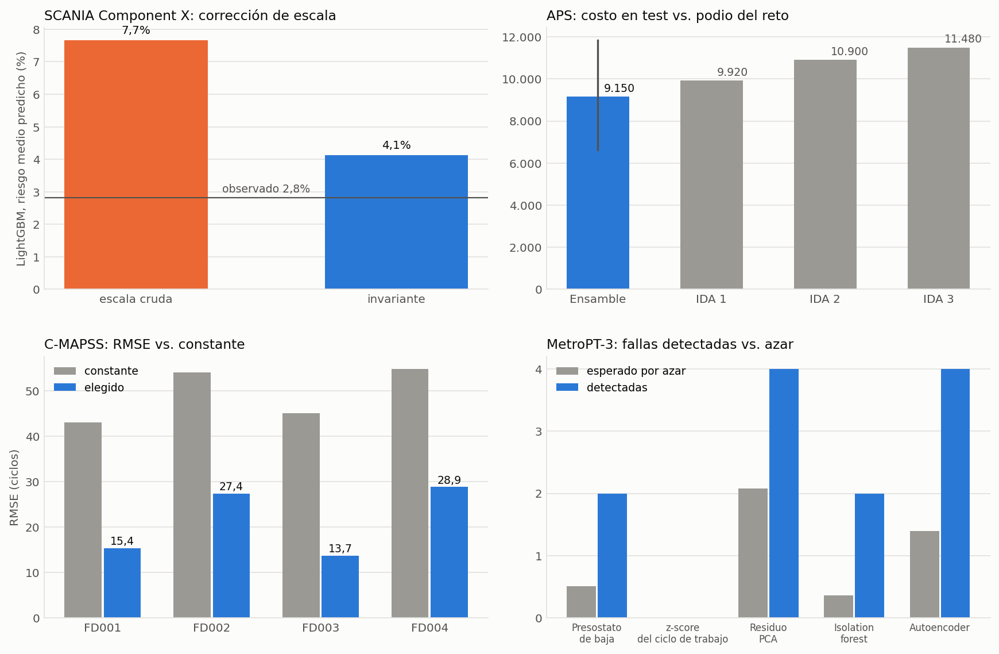

**[Página interactiva](https://rxyxs.github.io/heavy-truck-predictive-maintenance/)**: mueve el costo de una visita a taller y mira cómo cambian la decisión de SCANIA y su ahorro, con el modelo anterior y el nuevo.

## Resultados de un vistazo

| Dataset | Tarea | Datos | Modelo elegido sin el test | Resultado en test |
|---|---|---|---|---|
| [SCANIA Component X](#1-scania-component-x-decisión-de-riesgo-con-una-matriz-de-costos) | ventana de falla en 5 clases → acción de mantenimiento | reales, 33.641 camiones | MLP con features invariantes a la escala | costo oficial **24,2%** menor (IC95% 13,8–33,8); 37,0% en validación |
| [APS Failure at Scania Trucks](#2-aps-failure-at-scania-trucks-clasificación-ponderada-por-costo) | falla del sistema de aire, sí/no | reales, 76.000 camiones | promedio de LightGBM, XGBoost y CatBoost | costo **9.150** (IC95% 6.620–11.850); ganador del reto: 9.920 |
| [NASA C-MAPSS](#3-nasa-c-mapss-vida-útil-restante) | vida útil restante | simulados, 1.416 motores | elegido por subconjunto con validación cruzada agrupada (GRU o ensamble) | RMSE **15,4 / 27,4 / 13,7 / 28,9** en FD001–FD004; una constante saca 43–55 |
| [MetroPT-3](#4-metropt-3-detección-de-anomalías-sin-etiquetas) | detección de fugas de aire, sin etiquetas | reales, 1,5 M lecturas | cinco detectores informados lado a lado | autoencoder: **4 de 4** fugas, 1,4 esperadas por azar, 3,8 falsas alarmas/semana |

## Lo que encontré

1. **Los conjuntos de SCANIA Component X vienen en escalas distintas.** Cada variable anonimizada viene multiplicada por un factor propio (×0,16 a ×3,9), y el factor cambia entre entrenamiento, validación y test. Un clasificador separa lecturas de entrenamiento de las de validación con AUC 1,00. El mismo LightGBM con los mismos hiperparámetros exagera el riesgo entre 2,7 y 6,3 veces con features en escala cruda, y solo 1,5 veces con features que cancelan el factor (4,2% predicho contra 2,7% observado en validación). El costo de visita a taller en que se agota su ahorro sube de ×1,65 a ×4,14 en validación y de ×1,90 a ×2,90 en test. Al costo del propio reto la corrección no sube el ahorro en test (26,2% contra 28,5%). Lo que compra es una política que pierde mucho menos cuando las visitas se encarecen: a ×10, −12% en vez de −138% en validación y −45% en test.
2. **Una validación sacada del conjunto de entrenamiento no lo puede ver, y tampoco alcanza para elegir un ganador.** En camiones retenidos de entrenamiento, el modelo con escala cruda parece el mejor de todos (5.105 de costo esperado por 1.000 camiones). Solo los conjuntos con otra escala lo dejan en evidencia, y lo encontré con validación adversarial, que usa las features de validación y test pero nunca sus etiquetas. Entre los modelos invariantes, los puntajes en retenidos quedan dentro del ruido entre corridas. La MLP sacó 5.256 en una corrida en CPU y 5.116 en la corrida en GPU que informo aquí, lo que mueve la elección de XGBoost a la MLP. En test difieren en seis puntos (30,6% contra 24,2%), dentro de los intervalos de cada uno.
3. **En APS el umbral se transfiere.** El umbral que minimiza el costo se fija con predicciones de entrenamiento fuera de partición. Reajustarlo mirando el test, que no es un resultado válido, bajaría el costo del ensamble solo en 60 (9.150 → 9.090), así que la cifra informada no depende de dónde cayó el umbral.
4. **El periodo de referencia "sano" de MetroPT-3 no está sano.** El 29 de marzo el compresor trabajó en carga todo el día, la firma de una fuga, sin ninguna falla en el registro del operador. Un detector cuyo umbral de alarma se calibra en ese periodo queda ciego. El z-score del ciclo de trabajo no da ni una alarma en cinco meses, tampoco durante las cuatro fugas reportadas.
5. **Las redes neuronales ganan con secuencias simples y no con features tabulares.** En los subconjuntos de C-MAPSS con una sola condición, una GRU sobre los últimos 30 ciclos es el mejor modelo (RMSE en test 15,4 y 13,7, contra 17,9–18,8 del mejor árbol). Con seis condiciones de operación queda detrás de los árboles (29,7 y 30,7 contra 27,6 y 28,7), y la CNN 1D es ahí el peor modelo. En los dos problemas tabulares de Scania, la MLP alcanza su mejor pérdida de validación entre las épocas 3 y 13, y en test queda detrás del mejor boosting en ambos. Todas las redes corrieron al menos 100 épocas restaurando el mejor checkpoint, así que no es falta de entrenamiento.

## Arquitectura

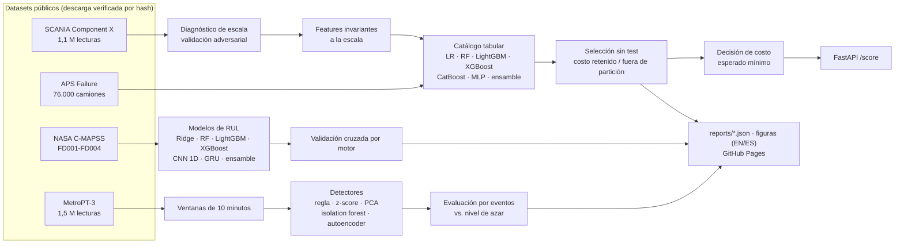

## Protocolo común

- **Nada se elige con el test.** SCANIA elige con camiones retenidos del entrenamiento, APS con predicciones de entrenamiento fuera de partición, C-MAPSS con validación cruzada agrupada por motor. MetroPT-3 no tiene etiquetas con qué elegir, así que se informan los cinco detectores. El test se mira una vez, con todos los modelos.
- **Parada temprana en un conjunto aparte.** El boosting y las redes paran con datos que no son ni la partición evaluada ni el test.
- **Redes neuronales** (PyTorch): mínimo 100 épocas, después parada temprana por paciencia, y se restaura y guarda el mejor checkpoint (`src/models/nets.py`). Usan la GPU si hay una.
- **Incertidumbre.** Intervalos bootstrap por camión para costos y ahorros. En MetroPT-3, un nivel de azar: la misma serie de alarmas desplazada en el tiempo 500 veces.
- **Hiperparámetros fijados de antemano**, iguales en todos los datasets salvo que se diga. Nada se ajusta con validación ni test.

---

## 1. SCANIA Component X: decisión de riesgo con una matriz de costos

[SCANIA Component X](https://researchdata.se/en/catalogue/dataset/2024-34) (CC BY 4.0) es el dataset del IDA 2024 Industrial Challenge: 23.550 camiones de entrenamiento (2.272 reparaciones de un componente de motor anonimizado), y 5.046 de validación y 5.045 de test con **una lectura elegida al azar por camión**, para simular que se está parado en "hoy". La etiqueta es el tiempo que falta para la reparación: 0 = más de 48 unidades de tiempo, 1–4 = 24–48, 12–24, 6–12 o 0–6. El reto puntúa cada recomendación con una matriz asimétrica. Una revisión innecesaria cuesta 7–10 y una falla no detectada 200–500, así que la referencia a batir es "no recomendar nada": 57.400 en validación y 56.100 en test.

<details>
<summary>Matriz de costos</summary>

| | recomendar 0 | 1 | 2 | 3 | 4 |
|---|---|---|---|---|---|
| **sano (0)** | 0 | 7 | 8 | 9 | 10 |
| **falla en 24–48 (1)** | 200 | 0 | 7 | 8 | 9 |
| **falla en 12–24 (2)** | 300 | 200 | 0 | 7 | 8 |
| **falla en 6–12 (3)** | 400 | 300 | 200 | 0 | 7 |
| **falla en 0–6 (4)** | 500 | 400 | 300 | 200 | 0 |

</details>

**Features.** Las 105 columnas operacionales son contadores e histogramas acumulados, así que las features son tasas de uso, fracciones de histograma y su cambio reciente, calculadas solo con el pasado de cada camión. Un test recalcula cada feature sobre historiales truncados para verificar que nada mira hacia adelante. La decisión es la acción de **menor costo esperado** con las probabilidades por clase del modelo, no la clase más probable.

### El cambio de escala oculto

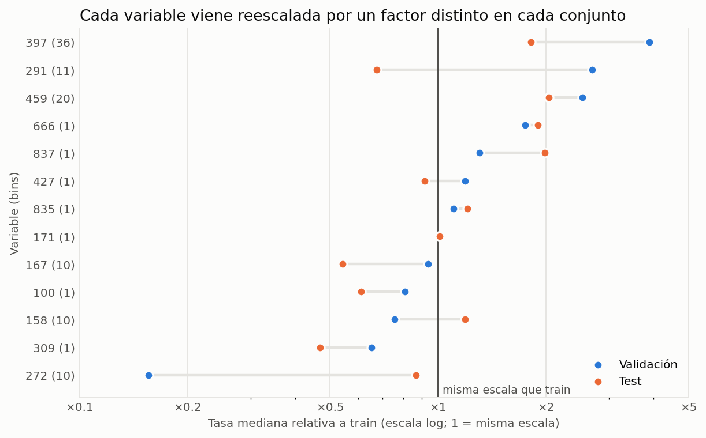

Al comparar la tasa de uso mediana de cada variable entre conjuntos aparece un factor por variable, consistente entre los bins de su histograma y distinto en cada conjunto. La variable 272 queda en ×0,16 de su escala de entrenamiento en validación y ×0,87 en test, y la 397 en ×3,9 y ×1,8. El artículo que describe el dataset dice que se aplicaron perturbaciones "como escalamiento"; no dice que difieran entre conjuntos.

| Validación adversarial (LightGBM, AUC en 5 particiones) | entrenamiento vs. validación | entrenamiento vs. test | validación vs. test |
|---|---:|---:|---:|
| Las 512 features de lectura | 1,00 | 1,00 | 1,00 |
| Solo features de lectura invariantes a la escala (302) | 0,82 | 0,81 | 0,67 |

Las tasas heredan el factor. Las fracciones de histograma y el cociente entre el ritmo reciente y el de toda la vida (`rel_rate_*`) lo cancelan. Lo que todavía separa los conjuntos una vez que la escala desaparece es sobre todo `time_step`: los cortes de validación y test caen más tarde en la vida de cada camión (mediana 169–172 unidades de tiempo, contra 109 en una lectura de entrenamiento al azar).

### Siete clasificadores, elegidos con camiones retenidos del entrenamiento

El entrenamiento usa todas las lecturas con riesgo y el 5% de las sanas (re-ponderadas ×20), separadas por camión en 70% ajuste, 15% parada temprana y 15% selección. El puntaje de selección es el costo oficial esperado en los camiones de selección, con cada lectura ponderada por 1 / (lecturas de su camión), que es exactamente el protocolo de una lectura al azar de validación y test.

| Modelo | Costo retenidos / 1.000 camiones | Ahorro validación (IC95%) | Ahorro test (IC95%) | Riesgo medio predicho (val. / test) | El ahorro se agota en (val. / test) |
|---|---:|---:|---:|---:|---:|
| Regresión logística | 5.254 | 31,8% (22,2–40,8) | 21,6% (11,3–30,5) | 3,5% / 3,4% | ×4,14 / ×2,35 |
| Bosque aleatorio | 7.756 | 21,0% (5,8–32,4) | 18,2% (3,7–30,1) | 17,3% / 17,1% | ×1,29 / ×1,24 |
| LightGBM | 5.385 | 31,4% (22,6–40,5) | 26,2% (16,6–34,7) | 4,2% / 4,1% | ×4,14 / ×2,90 |
| XGBoost (elegido en una corrida en CPU) | 5.131 | 41,5% (32,5–50,5) | 30,6% (19,7–39,5) | 3,6% / 3,6% | ×6,78 / ×4,60 |
| CatBoost | 5.296 | 37,6% (27,8–46,1) | 28,1% (17,2–36,7) | 3,2% / 3,2% | ×7,81 / ×3,12 |
| **MLP, PyTorch (elegido)** | **5.116** | **37,0% (26,9–46,0)** | **24,2% (13,8–33,8)** | **3,5% / 3,4%** | **×5,68 / ×2,04** |
| Ensamble (promedio de los 3 GBM) | 5.132 | 37,9% (28,8–46,4) | 28,9% (18,1–38,0) | 3,7% / 3,6% | ×6,10 / ×3,47 |
| *LightGBM con features en escala cruda (versión anterior)* | *5.105* | *28,7% (16,6–37,9)* | *28,5% (18,0–37,3)* | *16,9% / 7,7%* | *×1,65 / ×1,90* |

Tasa de falla observada: 2,7% en validación y 2,8% en test. "El ahorro se agota en" es el costo de una visita innecesaria, como múltiplo del 7–10 del reto, sobre el cual el ahorro cae bajo 1%.

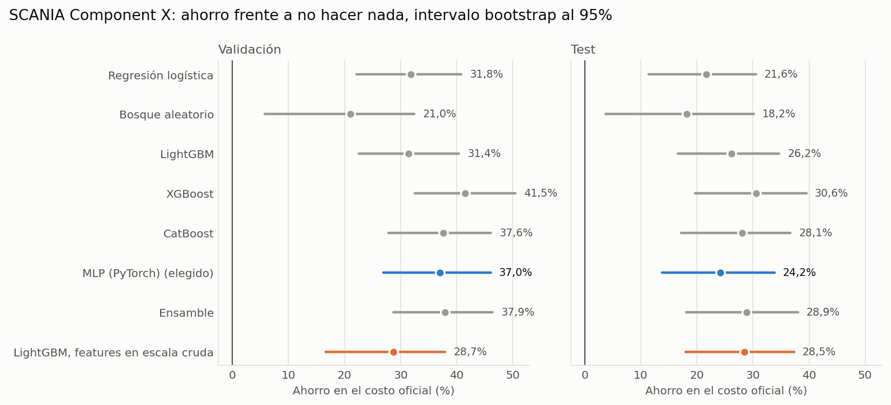

- **La elección es una moneda al aire entre los tres mejores.** En camiones retenidos, la MLP, XGBoost y el ensamble quedan a 16 puntos por 1.000 camiones, menos de lo que se mueve la MLP entre corridas (5.256 en una corrida en CPU, 5.116 en esta en GPU). La regla eligió la MLP aquí y XGBoost en la corrida en CPU. Informo la corrida tal como salió, en vez de repetirla hasta que la elección se viera mejor en test. En validación y test los intervalos de los buenos modelos se solapan: con 136 y 142 camiones que fallan no se distinguen con confianza.
- **El bosque aleatorio está mal calibrado** (17% de riesgo predicho). Sus hojas promedian las filas re-ponderadas del entrenamiento, y una hoja hecha solo de filas con riesgo predice 100% de riesgo. Es el peor modelo aquí por eso, no por falta de capacidad de ordenar (AUC 0,72 en validación).
- **El ahorro en test del modelo con escala cruda se ve bien** (28,5%), y así se escondió el problema en la versión anterior de este repositorio. Sus probabilidades no son creíbles, y la figura siguiente muestra lo que eso cuesta, comparándolo con el mismo LightGBM con features invariantes.

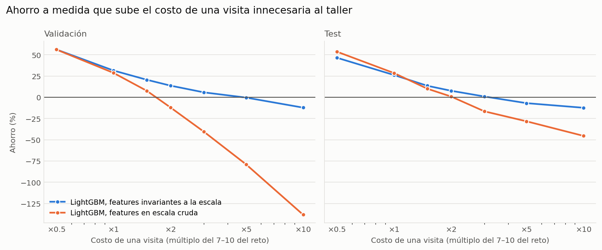

Con probabilidades creíbles, la política de costo esperado mínimo nunca debería quedar peor que no hacer nada. Simplemente debería alarmar menos a medida que las visitas se encarecen. Mismo modelo, mismos hiperparámetros, solo cambian las features. Con features en escala cruda, LightGBM pierde plata en cuanto una visita cuesta unas dos veces lo del reto, y llega a −138% (validación) y −45% (test) a ×10. Con features invariantes se mantiene sobre cero hasta ×3 y termina en −12% a ×10, porque todavía exagera el riesgo en sus tramos altos. A ×1 en test el modelo con escala cruda ahorra algo más (28,5% contra 26,2%), así que la corrección compra robustez frente al supuesto de costos, no un mejor puntaje con la matriz del propio reto.

<details>
<summary>Cómo se ve la decisión, tiempo hasta la falla, supervivencia y SHAP</summary>

**Decisión (MLP elegida, costo esperado mínimo).** Alarma a 85 de 136 camiones que fallan en validación (62%) y a 74 de 142 en test (52%), y al 31% y 30% de los camiones sanos. Más del 99% de sus alarmas son clase 4, así que en la práctica es un interruptor "alarma / sin alarma" y no distingue las ventanas intermedias. AUC ROC de "algún riesgo": 0,722 en validación y 0,654 en test (XGBoost: 0,744 y 0,706). Pendiente de Platt de su riesgo: 0,66 ajustada en validación y 0,43 en test, donde 1 sería una calibración perfecta.

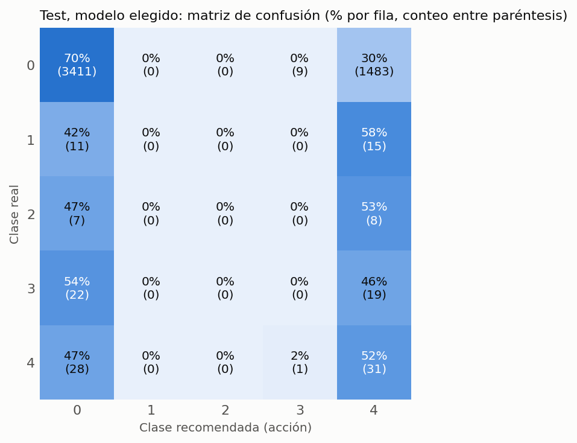

**Tiempo hasta la falla** (LightGBM sobre `log1p`, camiones que fallaron, 568 camiones retenidos): MAE 45,5 contra 67,1 de la mediana, y 39,5 contra 80,4 a menos de 48 unidades de la reparación. Supera al baseline pero no ubica la falla dentro de una ventana de 48 unidades, y es condicional a que el camión falle.

**Supervivencia desde un landmark de 50 unidades de tiempo** (23.333 camiones en riesgo; uso temprano + especificaciones; C-index en retenidos):

| Modelo | C-index |
|---|---:|
| Cox de riesgos proporcionales | 0,697 |
| Weibull AFT | 0,690 |
| Bosque de supervivencia aleatorio | **0,719** |
| Cox, solo especificaciones | 0,651 |
| Cox, solo uso temprano | 0,665 |

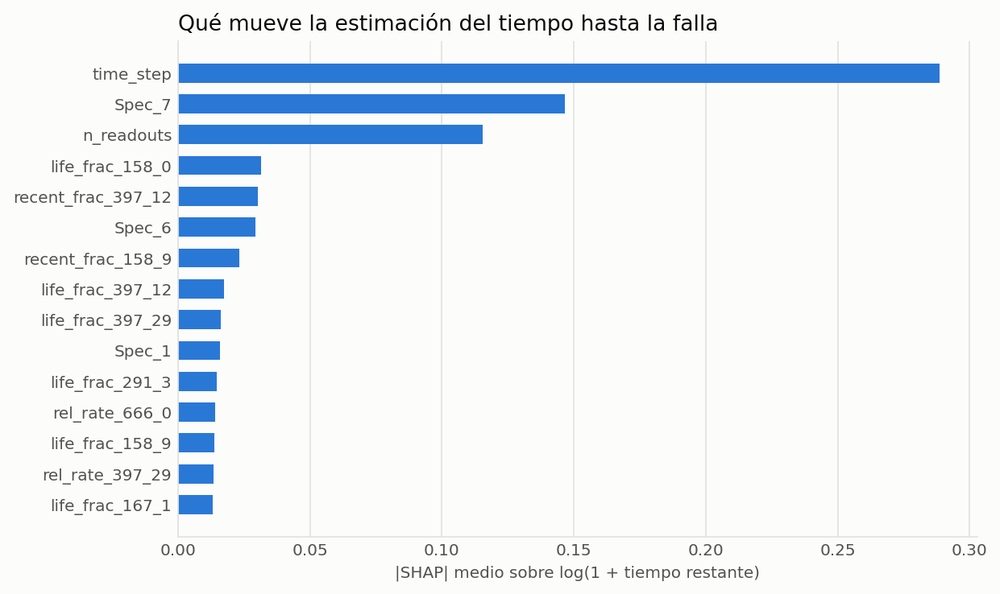

El modelo de tiempo hasta la falla se apoya en cuánto lleva operando el camión (`time_step`, `n_readouts`) y en su configuración (`Spec_7`). Las variables operacionales están anonimizadas, así que no hay diagnóstico físico.

</details>

<details>
<summary>Calibración: riesgo medio predicho sobre observado, todos los modelos</summary>

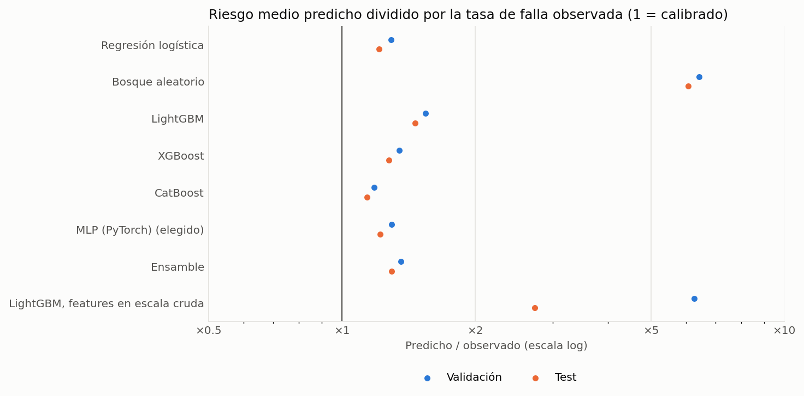

</details>

## 2. APS Failure at Scania Trucks: clasificación ponderada por costo

[APS Failure at Scania Trucks](https://archive.ics.uci.edu/dataset/421) (UCI, GPL-3.0, © Scania CV AB) es el dataset del reto IDA 2016. Cada camión es una fila de 170 contadores e histogramas anonimizados, y la clase positiva es la falla de un componente del sistema de presión de aire (frenos, cambios). El entrenamiento tiene 60.000 camiones (1.000 fallas, 1,7%) y el test 16.000 (375, 2,3%), con 8,3% de valores faltantes. Costo = 10 × revisiones innecesarias + 500 × fallas no detectadas. El archivo que acompaña a los datos trae el podio: **9.920 / 10.900 / 11.480**.

Protocolo: validación cruzada estratificada de 5 particiones sobre el entrenamiento (pesos balanceados por clase; el boosting y la MLP paran con el 15% de cada partición de ajuste). El umbral de alarma es el que minimiza el costo en las predicciones fuera de partición. La predicción de test es el promedio de los cinco modelos de partición. El elegido es el de menor costo fuera de partición.

| Modelo | Costo fuera de partición (60.000 camiones) | Costo en test (IC95%) | Falsas alarmas | No detectadas | PR-AUC test |
|---|---:|---:|---:|---:|---:|
| Regresión logística | 51.570 | 11.310 (8.439–14.720) | 631 | 10 | 0,844 |
| Bosque aleatorio | 42.120 | 9.400 (6.840–12.070) | 590 | 7 | 0,899 |
| LightGBM | 43.050 | 10.290 (7.040–13.680) | 479 | 11 | 0,881 |
| XGBoost | 44.140 | 10.340 (7.250–13.630) | 534 | 10 | 0,871 |
| CatBoost | 42.970 | 9.670 (7.370–12.270) | 667 | 6 | 0,876 |
| MLP (PyTorch) | 48.760 | 13.630 (9.760–17.940) | 513 | 17 | 0,838 |
| **Ensamble (elegido)** | **42.080** | **9.150 (6.620–11.850)** | **565** | **7** | 0,879 |

No hacer nada cuesta 187.500 y alarmar a todos los camiones 156.250.

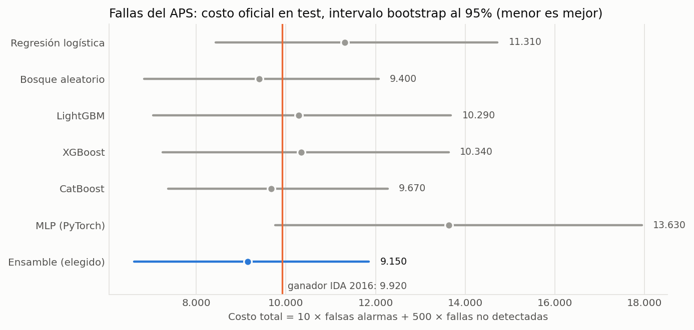

La estimación puntual del ensamble elegido queda bajo la del ganador del reto, pero el 9.920 del ganador cae dentro de su intervalo, así que lo leo como a la par, no como mejor. Los participantes tampoco tenían las etiquetas de test. La MLP alcanza su mejor pérdida de parada temprana entre las épocas 3 y 13 de las 100 que corrió en cada partición, y es el modelo más débil. Muchos resultados publicados con este dataset ajustan el umbral mirando el test, lo que no es un resultado válido. Hacerlo aquí bajaría el costo del ensamble solo en 60.

## 3. NASA C-MAPSS: vida útil restante

[C-MAPSS](https://www.nasa.gov/intelligent-systems-division/discovery-and-systems-health/pcoe/pcoe-data-set-repository/) es una **simulación** de turbinas de avión corridas hasta la falla, no datos de camiones. La incluyo porque es la vara pública estándar para la vida útil restante (RUL), con un puntaje asimétrico oficial. FD001–FD004 combinan una o seis condiciones de operación con uno o dos modos de falla.

Protocolo: la etiqueta de entrenamiento son los ciclos hasta la falla con techo de 125. El test se evalúa en el último ciclo observado de cada motor contra la RUL real, sin techo. Los sensores se estandarizan dentro de cada condición de operación (k-means sobre los tres ajustes). Los modelos tabulares ven el valor actual y la media, desviación y cambio en 10 ciclos de cada sensor. La CNN 1D y la GRU ven la secuencia cruda de los últimos 30 ciclos. La selección es validación cruzada de 5 particiones agrupada por motor; el ensamble es el promedio de los tres modelos con menor error de validación cruzada. Puntaje NASA: `exp(-d/13) - 1` si se adelanta, `exp(d/10) - 1` si se atrasa, `d` = predicción − verdad (menor es mejor).

RMSE en test sobre el último ciclo de cada motor (en negrita, el modelo elegido):

| Subconjunto | Motores (entren. / test) | Constante | Ridge | Bosque aleatorio | LightGBM | XGBoost | CNN 1D | GRU | Ensamble | Elegido por CV (RMSE de CV, puntaje NASA en test) |
|---|---|---:|---:|---:|---:|---:|---:|---:|---:|---|
| FD001 (1 condición, 1 modo de falla) | 100 / 100 | 43,1 | 22,1 | 19,1 | 18,8 | 18,9 | 16,4 | **15,4** | 15,1 | GRU (13,4; 465) |
| FD002 (6 condiciones, 1 modo) | 260 / 259 | 54,1 | 30,9 | 27,9 | 27,6 | 27,6 | 32,4 | 29,7 | **27,4** | ensamble de GRU, LightGBM y XGBoost (15,7; 9.546) |
| FD003 (1 condición, 2 modos) | 100 / 100 | 45,1 | 21,9 | 19,3 | 17,9 | 18,1 | 16,3 | **13,7** | 14,3 | GRU (12,1; 382) |
| FD004 (6 condiciones, 2 modos) | 249 / 248 | 54,9 | 33,3 | 29,4 | 28,7 | 28,9 | 33,0 | 30,7 | **28,9** | ensamble de bosque aleatorio, LightGBM y XGBoost (16,5; 6.027) |

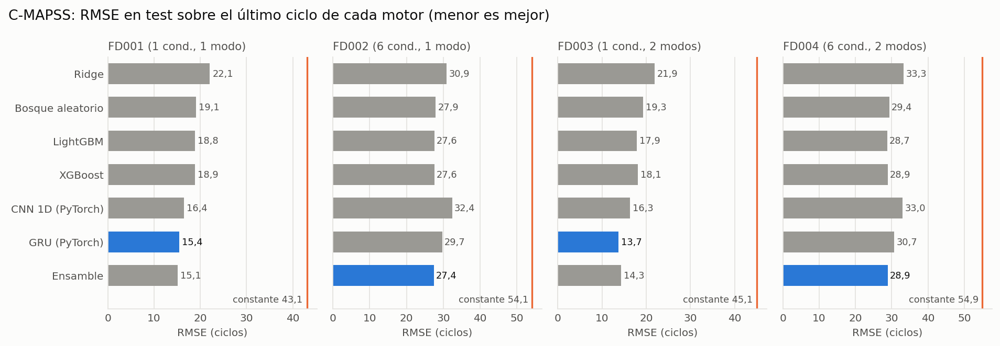

- **La GRU gana en los subconjuntos de una condición, los árboles en los de seis.** Con seis regímenes de operación la CNN 1D es el peor modelo en validación cruzada (21,8 y 20,7, detrás del 19,9 y 20,1 de Ridge), y la GRU queda detrás de los árboles en test. La estandarización por condición basta para las estadísticas de ventana, pero las secuencias crudas todavía traen cambios de régimen que las redes no absorben con esta cantidad de datos.
- **La validación cruzada subestima el error de test, sobre todo con seis condiciones** (15,7–16,5 contra 27,4–28,9 en los modelos elegidos). Los motores de test se cortan en un ciclo arbitrario, mientras que la validación cruzada evalúa todas las filas de motores que corren hasta la falla, incluidas las muchas filas del inicio de la vida que quedan en el techo de 125 y son fáciles.
- **El ensamble nunca queda lejos del mejor modelo**: a menos de 0,7 de RMSE del mejor puntaje en test en todos los subconjuntos, y es el mejor en FD001 y FD002.
- **Las redes dejan de aprender temprano.** Su mejor época de validación está entre la 2 y la 17 de las 100 que corrieron.
- **Son features simples con hiperparámetros fijos**, no un modelo del estado del arte, y no los comparo con resultados publicados.

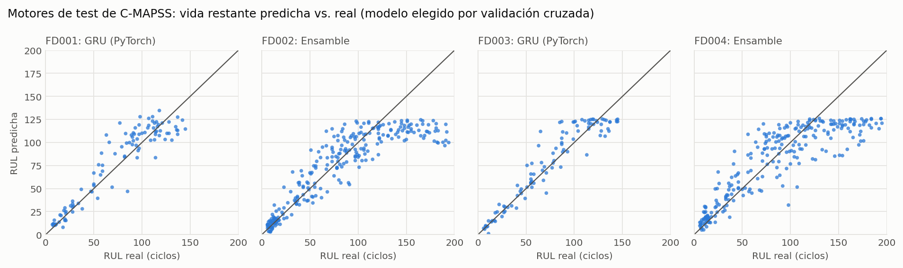

## 4. MetroPT-3: detección de anomalías sin etiquetas

[MetroPT-3](https://archive.ics.uci.edu/dataset/791) (UCI, CC BY 4.0) es la unidad de producción de aire del compresor de un tren de metro. Es el mismo tipo de sistema que el APS de un camión: aire comprimido para frenos y servicios. Tiene presiones, temperatura del aceite, corriente del motor y señales de válvulas de febrero a agosto de 2020, **sin etiquetas por fila**. El registro del operador lista cuatro fugas de aire, y contra ese registro se evalúan los detectores.

Dos cosas del archivo no coinciden con su descripción. Trae 1.516.948 filas, una lectura cada ~10 s, no 15 millones a 1 Hz. El registro de fallas numera sus filas "#1, #1, #3, #4" y fecha una reparación antes de su propia falla, que leo como un error de tipeo. Además hay 230 huecos de más de 10 minutos, 901 horas en total.

Protocolo: ventanas de 10 minutos (21 features: medias, dispersiones, presiones mínimas, fracción de tiempo activa de cada válvula, arranques del compresor). Los detectores se ajustan con el 1 de febrero – 15 de marzo, y el umbral de alarma es el percentil 99,5 del puntaje suavizado a 30 minutos en el 16–31 de marzo. La evaluación va del 1 de abril al 31 de agosto. Una fuga cuenta como detectada si hay alarma entre 2 h antes de su inicio reportado y su fin. Una falsa alarma es un episodio de alarma que empieza fuera de todas las zonas de falla. El nivel de azar es la misma serie de alarmas desplazada en el tiempo 500 veces: conserva cuánto alarma el detector pero no cuándo.

| Detector (vista de features) | Fugas detectadas (de 4) | Esperadas por azar | Falsas alarmas / semana | Tiempo normal en alarma |
|---|---:|---:|---:|---:|
| Presostato de baja que ya trae el equipo (regla) | 2 | 0,51 | 1,6 | 0,4% |
| z-score del ciclo de trabajo | 0 | 0,00 | 0,0 | 0,0% |
| Error de reconstrucción PCA | 4 | 2,08 | 7,0 | 19,7% |
| Isolation forest | 2 | 0,36 | 0,8 | 0,7% |
| **Autoencoder (PyTorch)** | **4** | **1,40** | **3,8** | **7,9%** |
| PCA, features ajustadas por deriva | 4 | 2,66 | 12,0 | 27,7% |
| Isolation forest, ajustadas por deriva | 2 | 0,46 | 1,1 | 0,7% |
| Autoencoder, ajustadas por deriva | 4 | 2,27 | 7,6 | 20,8% |

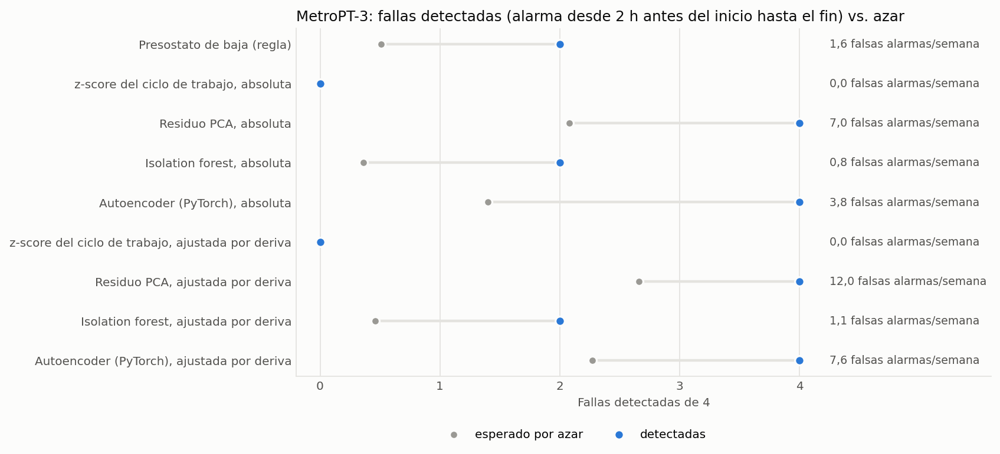

- **Detectar 4 de 4 dice poco por sí solo.** El detector PCA también lo logra, pero pasa el 20% del tiempo normal en alarma y el azar solo ya le daría 2,1. El autoencoder es el mejor compromiso: las cuatro fugas, 2,6 sobre el azar, con 3,8 falsas alarmas por semana. El isolation forest es la opción silenciosa, con 2 de 4 y menos de una falsa alarma por semana.
- **El presostato de baja que ya trae el equipo detecta 2 de 4, tarde.** Salta 34 h y 3 h después del inicio reportado de las fugas 3 y 4. Esa es la base que cualquier modelo tiene que superar.
- **Restar la mediana de los 7 días anteriores (ajuste por deriva) hizo más ruidosos a todos los detectores.** Esperaba que absorbiera la subida de verano del ciclo de trabajo y de la temperatura del aceite. No lo hizo, y lo informo tal como salió.
- **El z-score del ciclo de trabajo está ciego** porque su periodo de referencia incluye el 29 de marzo, un día al 100% de carga (ver el hallazgo 4). Mantuve el protocolo fijado en vez de mover la referencia después de ver el periodo de evaluación.

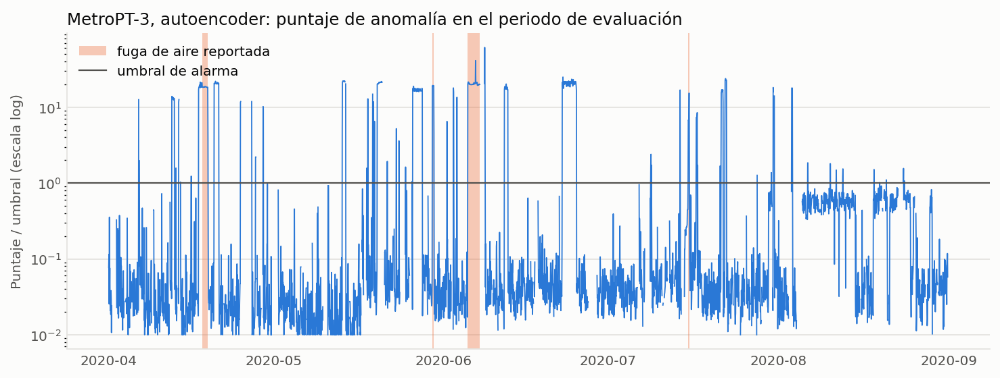

---

## Límites

- **Nada de esto son datos mineros.** Camiones de carretera, un compresor de metro y turbinas simuladas comparten la estructura del mantenimiento de una flota minera (contadores de uso, fallas raras y caras, censura), pero no tengo evidencia de que los números se transfieran a una faena.
- **Los factores de escala de SCANIA son una inferencia.** Los deduzco de los datos. Son consistentes entre los bins de cada variable, pero el dataset no los documenta por conjunto.
- **Pocas fallas.** 136 y 142 camiones SCANIA que fallan, 375 fallas APS, 4 fugas en MetroPT. Los intervalos son anchos, y en MetroPT-3 cuatro eventos no alcanzan para ordenar detectores con confianza.
- **Las matrices de costos son las de los retos.** Los ahorros valen lo que valgan esas cifras. El análisis de sensibilidad de SCANIA y la página interactiva existen para eso.
- **Variables anonimizadas** (SCANIA, APS), así que no hay diagnóstico físico.
- **Hiperparámetros fijos.** No ajusté nada, así que cada modelo probablemente podría mejorar algo. La comparación es entre familias con el mismo presupuesto, no entre sus mejores versiones posibles.
- **Las redes en GPU varían en los últimos decimales** entre corridas y hardware. Los demás modelos son deterministas con las semillas del código.

## Reproducir

```bash
python -m venv .venv && source .venv/bin/activate   # Windows: .venv\Scripts\activate
pip install -r requirements.txt                     # PyTorch solo CPU: pip install torch --index-url https://download.pytorch.org/whl/cpu

python -m src.cli download    # ~2,1 GB en data/raw (verificados por hash)
python -m src.cli all         # scania, aps, cmapss, metropt, figures, site
pytest                        # pruebas con datos sintéticos; las que necesitan un dataset se omiten si falta
```

Tiempos en una CPU de 16 núcleos con una RTX 4060 Ti: SCANIA ~30 min (CatBoost toma ~10), APS ~10 min, C-MAPSS ~40 min, MetroPT-3 ~1 min. Cada paso corre por separado: `python -m src.cli scania`, etc.

Salidas: `reports/<dataset>/results.json`, figuras en `reports/figures/{en,es}/` y la página en `docs/`. Los modelos y checkpoints van a `data/processed/models/`, que no se versiona.

## API

`POST /score` recibe el historial de lecturas de un camión SCANIA y sus `Spec_0…Spec_7`, y devuelve las probabilidades por clase, el costo esperado de cada acción y la recomendada. Exige el header `X-API-Key` y limita las solicitudes por IP. `GET /health` es abierto.

```bash
export RISK_API_KEY=change-me
uvicorn src.api.main:app
```

El modelo es el clasificador SCANIA elegido, con features invariantes a la escala. Sus probabilidades se recalibran con un Platt único ajustado en validación y test juntos, para servirlas y no para informar desempeño. `probabilidad_algun_riesgo_cruda` entrega el valor crudo.

## Estructura

```
src/cli.py                      punto de entrada único (download, scania, aps, cmapss, metropt, figures, site, all)
src/data/                       un cargador por dataset: descarga con verificación SHA-256, lectura, etiquetas
src/features/engineering.py     features por lectura de SCANIA, incluido el subconjunto invariante a la escala
src/models/zoo.py               interfaz común para LR, RF, LightGBM, XGBoost, CatBoost y la MLP
src/models/nets.py              bucle de entrenamiento PyTorch: mín. 100 épocas, parada temprana, checkpoints
src/models/evaluation.py        umbral de costo mínimo, intervalos bootstrap
src/models/train_pipeline.py    SCANIA: diagnóstico de escala, clasificadores, tiempo hasta la falla, supervivencia, SHAP
src/models/aps_pipeline.py      APS: catálogo de modelos con validación cruzada bajo el costo del reto
src/models/rul_estimator.py     modelos de C-MAPSS (tabulares y de secuencia)
src/models/rul_benchmark.py     benchmark C-MAPSS FD001-FD004
src/models/metropt_pipeline.py  MetroPT-3: ventanas, detectores, evaluación por eventos, nivel de azar
src/models/make_figures.py      todas las figuras, en inglés y español
src/models/cost_decision.py     decisión de costo esperado mínimo con la matriz de SCANIA
src/models/calibration.py       tablas de calibración, Platt, sensibilidad al costo de la visita
src/site.py                     genera la página de GitHub Pages (docs/, generada)
src/api/main.py                 servicio FastAPI
tests/                          pruebas unitarias con datos sintéticos y chequeos de consistencia de los resultados
```

Una versión anterior de este repositorio corría sobre un generador de datos sintéticos y tenía una red multitarea en PyTorch y un dashboard en Streamlit. Los quité al pasar a datos reales; siguen en el historial de git.

## Licencia y datos

Código: MIT. Los datos no se redistribuyen aquí (cada cargador los descarga desde la fuente):

- SCANIA Component X: © Scania CV AB, CC BY 4.0. Lindgren et al., *SCANIA Component X dataset: a real-world multivariate time series dataset for predictive maintenance*, [arXiv:2401.15199](https://arxiv.org/abs/2401.15199).
- APS Failure at Scania Trucks: © Scania CV AB, GNU GPL v3, UCI Machine Learning Repository.
- NASA C-MAPSS: Saxena et al., *Damage propagation modeling for aircraft engine run-to-failure simulation*, PHM 2008. NASA Prognostics Center of Excellence.
- MetroPT-3: Veloso et al., *The MetroPT dataset for predictive maintenance*, Scientific Data 9, 764 (2022). CC BY 4.0, UCI Machine Learning Repository.
