# Mantenimiento predictivo con datos reales de vehículos pesados

[[English](README.md) ] | [Español ]


**¿Qué camiones deberían ir al taller, y cuánto se ahorra con eso?** Cuatro datasets públicos de mantenimiento predictivo (dos flotas reales de camiones Scania, el compresor de aire de un tren de metro y el benchmark de turbinas de la NASA), ocho familias de modelos y una regla en todo el repositorio: nada se elige mirando el test, y cada cifra principal lleva un intervalo o un nivel de azar.

**[Página interactiva](https://rxyxs.github.io/heavy-truck-predictive-maintenance/)** · **[Notebook de 5 minutos](notebooks/quickstart.ipynb)** · **[La API en Docker](#pruébalo-en-dos-minutos)** · **[Release del modelo](https://github.com/Rxyxs/heavy-truck-predictive-maintenance/releases)**


## De un vistazo

| Dataset | Tarea | Datos | Modelo elegido sin el test | Resultado en test |
|---|---|---|---|---|
| [SCANIA Component X](#1-scania-component-x-decisión-de-riesgo-con-una-matriz-de-costos) | ventana de falla en 5 clases → acción de mantenimiento | reales, 33.641 camiones | promedio de LightGBM, XGBoost y CatBoost, cada uno promediado sobre 3 semillas | costo oficial **29,1%** menor (IC95% 18,6–37,6); 41,7% en validación |
| [APS Failure at Scania Trucks](#2-aps-failure-at-scania-trucks-clasificación-ponderada-por-costo) | falla del sistema de aire, sí/no | reales, 76.000 camiones | promedio de LightGBM, XGBoost y CatBoost | costo **9.150** (IC95% 6.620–11.850); ganador del reto: 9.920 |
| [NASA C-MAPSS](#3-nasa-c-mapss-vida-útil-restante) | vida útil restante | simulados, 1.416 motores | elegido por subconjunto con validación cruzada agrupada (GRU o ensamble) | RMSE **15,4 / 27,4 / 13,7 / 28,9** en FD001–FD004; una constante saca 43–55 |
| [MetroPT-3](#4-metropt-3-detección-de-anomalías-sin-etiquetas) | detección de fugas de aire, sin etiquetas | reales, 1,5 M lecturas | cinco detectores informados lado a lado | autoencoder: **4 de 4** fugas con las 6 semillas (~2 esperadas por azar), 5,5–13,7 falsas alarmas/semana |

## Hallazgos principales

1. **Los conjuntos de SCANIA Component X vienen en escalas distintas.** Cada variable anonimizada viene multiplicada por un factor propio (×0,16 a ×3,9) que cambia entre entrenamiento, validación y test; un clasificador distingue los conjuntos con AUC 1,00. Con features que cancelan el factor, el mismo LightGBM predice 4,2% de riesgo medio en vez de 16,9% (2,7% observado), y su ahorro aguanta visitas a taller de hasta ×4,14 (validación) y ×3,12 (test) el costo del reto, en vez de ×1,65 y ×1,90. [Detalle](#el-cambio-de-escala-oculto)
2. **Una semilla por modelo elige la inicialización más afortunada.** Reentrenado con tres semillas, el puntaje en retenidos de cada familia se mueve hasta 185 por 1.000 camiones, más que la distancia entre los mejores modelos. Promediar cada familia sobre sus semillas estabiliza la selección y mejora los modelos mismos: el costo en retenidos de LightGBM pasa de 5.382–5.419 por semilla a 5.208 promediado. [Detalle](#cuánto-del-orden-es-ruido)
3. **En APS el umbral se transfiere.** Se fija con predicciones de entrenamiento fuera de partición; reajustarlo mirando el test (no válido) bajaría el costo solo en 60. [Detalle](#2-aps-failure-at-scania-trucks-clasificación-ponderada-por-costo)
4. **La referencia "sana" de MetroPT-3 no está sana, y su autoencoder depende de la semilla.** El 29 de marzo el compresor trabajó en carga todo el día sin ninguna falla en el registro, lo que deja ciego a un detector del ciclo de trabajo. El autoencoder detecta las cuatro fugas con todas las semillas, pero sus falsas alarmas van de 5,5 a 13,7 por semana. [Detalle](#4-metropt-3-detección-de-anomalías-sin-etiquetas)
5. **Los modelos de secuencia ganan con secuencias simples, no con flotas ruidosas.** Una GRU es el mejor modelo en los subconjuntos de C-MAPSS con una condición (RMSE 15,4 y 13,7), pero sobre los historiales de lecturas de SCANIA ahorra 21,1% en test contra 29,1% del ensamble de boosting, y la MLP queda detrás del boosting en los dos problemas tabulares.

## Pruébalo en dos minutos

El modelo entrenado de SCANIA está publicado como archivo del release, así que la API corre sin descargar datos ni entrenar nada:

```bash
docker build -t truck-risk .
docker run -p 8000:8000 -e RISK_API_KEY=change-me truck-risk
curl -s -X POST localhost:8000/score -H "X-API-Key: change-me" -H "Content-Type: application/json" \
     --data @examples/truck_189_class4.json
```

O sin Docker: `pip install -r requirements.txt`, luego `python -m src.demo fetch-model` y `python -m src.demo score`. Los cuatro camiones de ejemplo son camiones reales de validación, elegidos para mostrar los dos lados del modelo:

| Ejemplo | Qué pasó de verdad | Lecturas | Riesgo predicho | Recomendación |
|---|---|---:|---:|---|
| `truck_10_class0.json` | sin reparación en 48 unidades | 102 | 1,3% | sin acción (clase 0) |
| `truck_1285_class3.json` | reparado 6–12 unidades después | 109 | 6,1% | sacar de operación ahora (clase 4) |
| `truck_189_class4.json` | reparado antes de 6 unidades | 61 | 4,1% | revisión urgente (clase 3) |
| `truck_3309_class4.json` | reparado antes de 6 unidades | 32 | 1,1% | sin acción (clase 0) |

Con los costos del reto el modelo deja pasar cerca de cuatro de cada diez camiones que fallan, y el 3309 es uno de ellos.

## Arquitectura

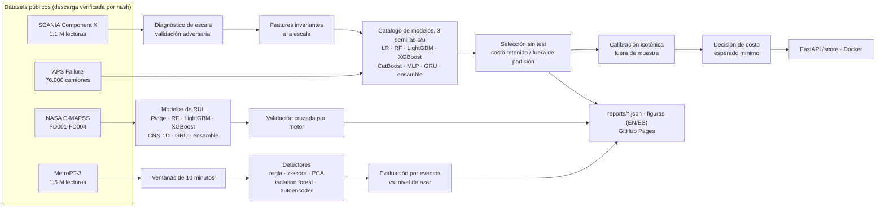

## Protocolo común

- **Nada se elige con el test.** SCANIA elige con camiones retenidos del entrenamiento, APS con predicciones de entrenamiento fuera de partición, C-MAPSS con validación cruzada agrupada por motor. MetroPT-3 no tiene etiquetas con qué elegir, así que se informan los cinco detectores. El test se mira una vez, con todos los modelos.
- **Parada temprana en un conjunto aparte.** El boosting y las redes paran con datos que no son ni la partición evaluada ni el test.
- **Redes neuronales** (PyTorch): mínimo 100 épocas, después parada temprana por paciencia, y se restaura y guarda el mejor checkpoint (`src/models/nets.py`). Usan la GPU si hay una.
- **Semillas.** Cada familia de SCANIA se entrena con tres semillas y se elige con sus probabilidades promediadas; el autoencoder de MetroPT se informa sobre seis semillas.
- **Incertidumbre.** Intervalos bootstrap por camión para costos y ahorros, y bootstrap pareado entre modelos. En MetroPT-3, un nivel de azar: la misma serie de alarmas desplazada en el tiempo 500 veces.
- **Hiperparámetros fijados de antemano**, iguales en todos los datasets salvo que se diga. Nada se ajusta con validación ni test.

---

## 1. SCANIA Component X: decisión de riesgo con una matriz de costos

[SCANIA Component X](https://researchdata.se/en/catalogue/dataset/2024-34) (CC BY 4.0) es el dataset del IDA 2024 Industrial Challenge: 23.550 camiones de entrenamiento (2.272 reparaciones de un componente de motor anonimizado), y 5.046 de validación y 5.045 de test con **una lectura elegida al azar por camión**, para simular que se está parado en "hoy". La etiqueta es el tiempo que falta para la reparación: 0 = más de 48 unidades de tiempo, 1–4 = 24–48, 12–24, 6–12 o 0–6. El reto puntúa cada recomendación con una matriz asimétrica. Una revisión innecesaria cuesta 7–10 y una falla no detectada 200–500, así que la referencia a batir es "no recomendar nada": 57.400 en validación y 56.100 en test.

<details>
<summary>Matriz de costos</summary>

| | recomendar 0 | 1 | 2 | 3 | 4 |
|---|---|---|---|---|---|
| **sano (0)** | 0 | 7 | 8 | 9 | 10 |
| **falla en 24–48 (1)** | 200 | 0 | 7 | 8 | 9 |
| **falla en 12–24 (2)** | 300 | 200 | 0 | 7 | 8 |
| **falla en 6–12 (3)** | 400 | 300 | 200 | 0 | 7 |
| **falla en 0–6 (4)** | 500 | 400 | 300 | 200 | 0 |

</details>

**Features.** Las 105 columnas operacionales son contadores e histogramas acumulados, así que las features son tasas de uso, fracciones de histograma y su cambio reciente, calculadas solo con el pasado de cada camión. Un test recalcula cada feature sobre historiales truncados para verificar que nada mira hacia adelante. La decisión es la acción de **menor costo esperado** con las probabilidades por clase del modelo, no la clase más probable.

### El cambio de escala oculto


Al comparar la tasa de uso mediana de cada variable entre conjuntos aparece un factor por variable, consistente entre los bins de su histograma y distinto en cada conjunto. La variable 272 queda en ×0,16 de su escala de entrenamiento en validación y ×0,87 en test, y la 397 en ×3,9 y ×1,8. El artículo que describe el dataset dice que se aplicaron perturbaciones "como escalamiento"; no dice que difieran entre conjuntos.

| Validación adversarial (LightGBM, AUC en 5 particiones) | entrenamiento vs. validación | entrenamiento vs. test | validación vs. test |
|---|---:|---:|---:|
| Las 512 features de lectura | 1,00 | 1,00 | 1,00 |
| Solo features de lectura invariantes a la escala (302) | 0,82 | 0,81 | 0,67 |

Las tasas heredan el factor. Las fracciones de histograma y el cociente entre el ritmo reciente y el de toda la vida (`rel_rate_*`) lo cancelan. Lo que todavía separa los conjuntos una vez que la escala desaparece es sobre todo `time_step`:

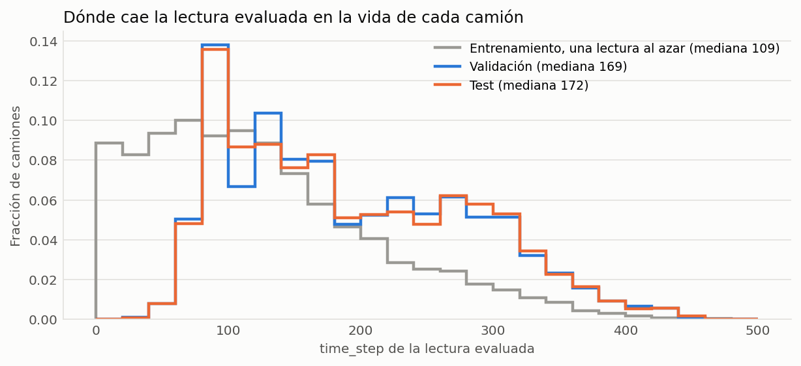

El dataset describe la lectura de validación y test como "elegida al azar entre todas las lecturas" de cada camión. No es uniforme. Una lectura de entrenamiento al azar cae antes del tiempo 60 en el 26,5% de los camiones, pero las de validación y test solo en el 0,9%, y su mediana está en 169–172 unidades de tiempo contra 109. El modelo entrena con lecturas del inicio de la vida con las que nunca se lo evalúa. Los pesos de selección (1 / lecturas del camión) suponen el protocolo documentado, así que tampoco lo corrigen.

### Ocho clasificadores, elegidos con camiones retenidos del entrenamiento

El entrenamiento usa todas las lecturas con riesgo y el 5% de las sanas (re-ponderadas ×20), separadas por camión en 70% ajuste, 15% parada temprana y 15% selección. El puntaje de selección es el costo oficial esperado en los camiones de selección, con cada lectura ponderada por 1 / (lecturas de su camión), el protocolo de una lectura al azar de validación y test. **Cada familia se entrena con tres semillas y se promedian sus probabilidades** (la regresión logística no tiene aleatoriedad y corre una vez). La GRU lee las últimas 8 lecturas de cada camión con las 48 features invariantes de mayor ganancia en LightGBM.

| Modelo (probabilidades promediadas sobre sus semillas) | Costo retenidos / 1.000 camiones | Ahorro validación (IC95%) | Ahorro test (IC95%) | Riesgo medio predicho (val. / test) | El ahorro se agota en (val. / test) |
|---|---:|---:|---:|---:|---:|
| Regresión logística (1 semilla, determinista) | 5.254 | 31,8% (22,2–40,8) | 21,6% (11,3–30,5) | 3,5% / 3,4% | ×4,14 / ×2,35 |
| Bosque aleatorio | 7.758 | 21,4% (5,7–32,6) | 18,8% (4,1–30,5) | 17,3% / 17,1% | ×1,29 / ×1,20 |
| LightGBM | 5.208 | 37,6% (28,3–46,1) | 30,1% (19,2–38,6) | 4,2% / 4,2% | ×4,14 / ×3,12 |
| XGBoost | 5.089 | 41,8% (32,7–50,1) | 32,7% (22,0–41,5) | 3,6% / 3,6% | ×10,73 / ×4,60 |
| CatBoost | 5.348 | 40,2% (30,3–48,3) | 26,2% (15,7–35,1) | 3,1% / 3,1% | ×7,81 / ×3,59 |
| MLP (PyTorch) | 5.127 | 36,9% (26,4–46,1) | 25,8% (15,5–35,5) | 3,7% / 3,7% | ×10,00 / ×2,61 |
| GRU sobre las últimas 8 lecturas (PyTorch) | 5.432 | 34,8% (24,4–44,0) | 21,1% (10,7–30,6) | 3,1% / 3,1% | ×3,59 / ×2,90 |
| **Ensamble de las 3 familias de boosting (elegido)** | **5.019** | **41,7% (32,4–50,3)** | **29,1% (18,6–37,6)** | **3,7% / 3,6%** | **×6,32 / ×3,99** |
| *LightGBM con features en escala cruda (versión anterior, 1 semilla) | 5.105 | 28,7% (16,6–37,9) | 28,5% (18,0–37,3) | 16,9% / 7,7% | ×1,65 / ×1,90* |

Tasa de falla observada: 2,7% en validación y 2,8% en test. "El ahorro se agota en" es el costo de una visita innecesaria, como múltiplo del 7–10 del reto, sobre el cual el ahorro cae bajo 1%.


- **El ensamble de boosting se elige en los camiones retenidos (5.019 por 1.000), y XGBoost solo es el mejor modelo en test.** El bootstrap pareado de abajo pone a XGBoost delante del ensamble elegido en el 99,6% de las réplicas de test (+3,7 puntos, intervalo 95% +0,7 a +7,1), pero empatan en validación (+0,1 puntos, 52%). Con 136 y 142 camiones que fallan, los intervalos de los buenos modelos se solapan.
- **Leer la trayectoria no ayuda.** La GRU sobre las últimas 8 lecturas ahorra 21,1% en test, bajo todos los modelos de boosting: las features de ritmo reciente ya resumen lo que agrega la historia, y la red se sobreajusta en 4–5 épocas.
- **El bosque aleatorio está mal calibrado** (17% de riesgo predicho). Sus hojas promedian las filas re-ponderadas del entrenamiento, así que una hoja hecha solo de filas con riesgo predice 100%. Ordena razonablemente (AUC 0,64 en test); el problema son sus probabilidades.
- **El ahorro en test del modelo con escala cruda se ve bien** (28,5%), y así se escondió el problema de escala en la versión anterior de este repositorio. Sus probabilidades no son creíbles, y la sección de robustez muestra lo que eso cuesta.

### Cuánto del orden es ruido

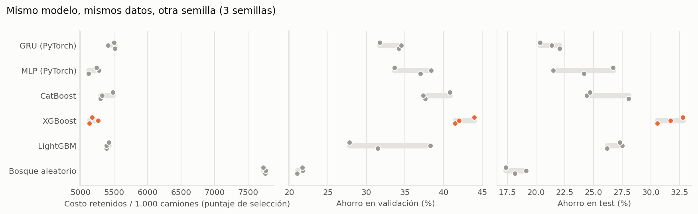

| Familia | Costo retenidos, semillas 42 / 1 / 2 | Promedio de semillas | Ahorro test, semillas 42 / 1 / 2 | Promedio |
|---|---:|---:|---:|---:|
| LightGBM | 5.385 / 5.382 / 5.419 | **5.208** | 26,2% / 27,5% / 27,3% | 30,1% |
| XGBoost | 5.131 / 5.263 / 5.173 | **5.089** | 30,6% / 31,7% / 32,8% | 32,7% |
| CatBoost | 5.296 / 5.322 / 5.481 | **5.348** | 28,1% / 24,4% / 24,7% | 26,2% |
| MLP | 5.116 / 5.271 / 5.237 | **5.127** | 24,2% / 21,5% / 26,7% | 25,8% |
| GRU | 5.512 / 5.406 / 5.497 | **5.432** | 22,1% / 21,4% / 20,4% | 21,1% |
| Bosque aleatorio | 7.756 / 7.762 / 7.726 | **7.758** | 18,2% / 19,1% / 17,4% | 18,8% |

La primera versión de este pipeline entrenaba cada familia una vez, con la semilla 42. Eso eligió la MLP, porque la semilla 42 fue su mejor resultado (5.116, contra 5.237–5.271 con las otras), y en test la MLP ahorraba menos que cualquier modelo de boosting. Promediar semillas saca esa suerte de la selección, y los modelos promediados son mejores que su semilla típica: LightGBM pasa de 5.382–5.419 por semilla a 5.208. Este es el protocolo v2; lo adopté después del análisis por semillas, que usa camiones retenidos y no el test, e informo todas las familias con él.

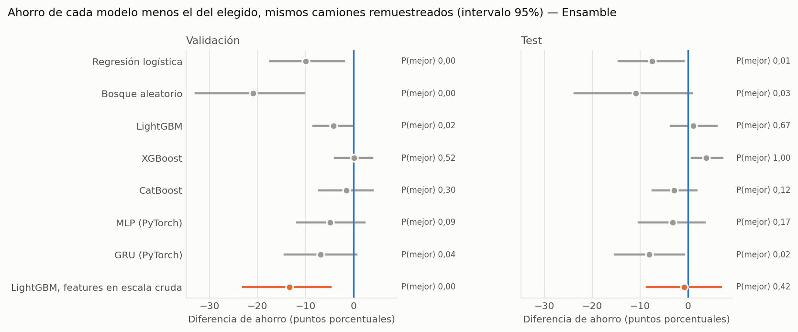

El bootstrap pareado remuestrea los mismos camiones para todos los modelos, lo que quita el ruido que comparten. En test, XGBoost le gana al ensamble elegido en el 99,6% de las réplicas y LightGBM en el 67%; CatBoost, la MLP y el modelo con escala cruda no (12–42%). En validación solo XGBoost lo empata (52%).

### Robustez frente al supuesto de costos


Con probabilidades creíbles, la política de costo esperado mínimo nunca debería quedar peor que no hacer nada; simplemente debería alarmar menos a medida que las visitas se encarecen. Mismo modelo y mismos hiperparámetros, solo cambian las features: con features en escala cruda LightGBM pierde plata en cuanto una visita cuesta unas dos veces lo del reto y llega a −138% (validación) y −45% (test) a ×10. Con features invariantes se mantiene sobre cero hasta ×3 y termina en −10% y −14%. A ×1 el modelo invariante ahora también ahorra más en test (30,1% contra 28,5%), pero la ganancia principal es la robustez frente al supuesto de costos.

**Calibrar fuera de muestra ayuda un poco más.** Una regresión isotónica ajustada en los camiones de selección (retenidos del entrenamiento, nunca validación ni test) sube el ahorro del ensamble elegido de 41,7% a 44,1% en validación y de 29,1% a 30,9% en test, y lo mantiene cerca de cero a ×10 en vez de negativo. La API sirve estas probabilidades calibradas.

### De dónde sale el costo, y con cuánta anticipación se ve una falla

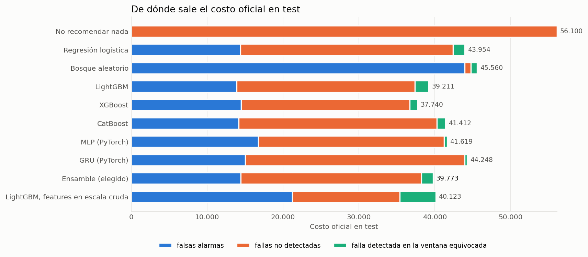

No hacer nada cuesta 56.100 en test, todo en fallas no detectadas. El ensamble elegido elimina más de la mitad de eso y agrega 14.430 en falsas alarmas; las fallas no detectadas siguen siendo la mayor parte de lo que queda (23.800 de 39.773). El modelo con escala cruda llega a un total parecido al revés, alarmando más (21.207) y dejando pasar menos (14.200), como hace un modelo que exagera el riesgo. El bosque aleatorio alarma a casi todos (43.940 en falsas alarmas).

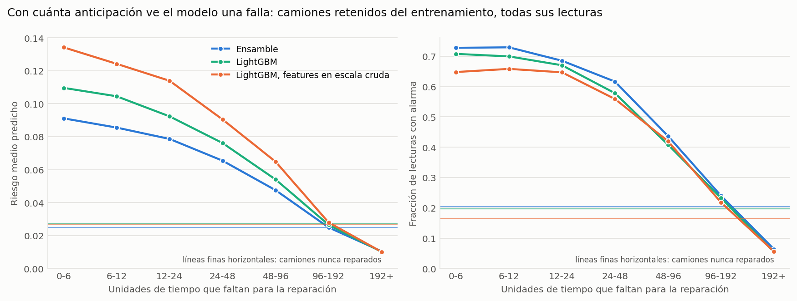

En todas las lecturas de los camiones retenidos del entrenamiento, la fracción que recibe alarma sube de forma sostenida a medida que se acerca la reparación. Con el ensamble elegido es 6% a más de 192 unidades, 24% a 96–192, 44% a 48–96 y 73% en las últimas 6, contra 20% en camiones que nunca se reparan. La señal es una deriva lenta que empieza 100–200 unidades de tiempo antes de la reparación, mucho antes de la ventana de 48 unidades que puntúa el reto, y por eso el modelo no distingue las ventanas y recomienda casi siempre la clase 4.

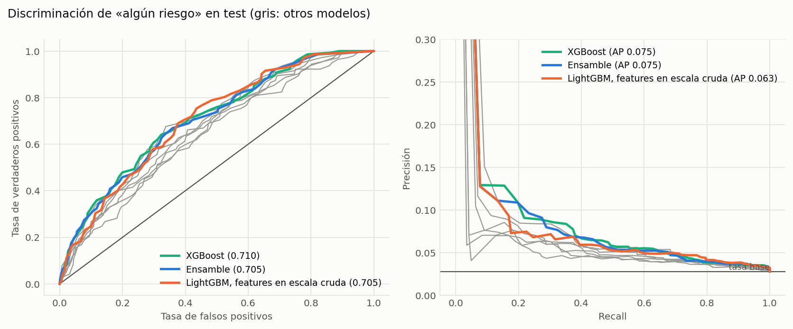

La capacidad de ordenar es modesta y parecida entre los modelos de boosting: AUC ROC de "algún riesgo" 0,70–0,71 en test para XGBoost, LightGBM, el ensamble y el modelo con escala cruda, 0,66 para la MLP y 0,65 para la GRU. La precisión promedio es 0,05–0,08 contra una tasa base de 0,028.

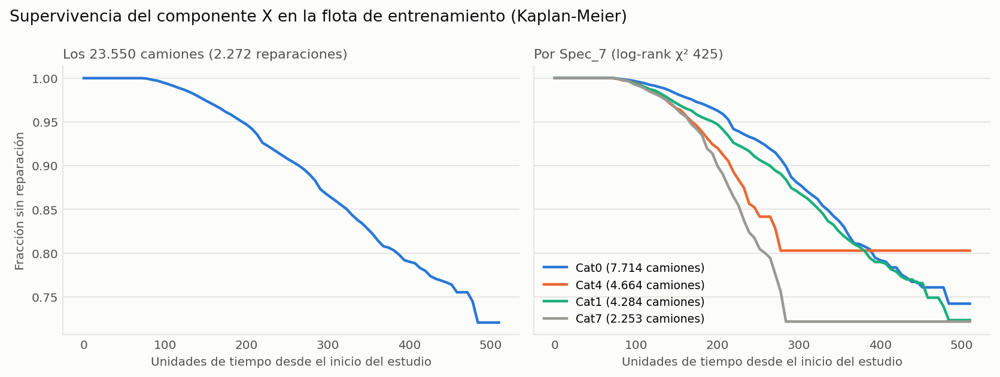

Durante el estudio, el 9,6% de los camiones de entrenamiento tuvo una reparación del componente X. De las ocho especificaciones anonimizadas, `Spec_7` es la que más separa la supervivencia (log-rank χ² 425, p < 10⁻⁸⁰). Su categoría Cat1 tiene 14,1% de reparaciones contra 7,0% de Cat4, mientras que `Spec_5` no la separa en absoluto (p = 0,36). `Spec_7` es además la segunda variable más importante del modelo de tiempo hasta la falla.

<details>
<summary>Cómo se ve la decisión, tiempo hasta la falla, modelos de supervivencia y SHAP</summary>

**Decisión (ensamble elegido, costo esperado mínimo).** Alarma a 96 de 136 camiones que fallan en validación (71%) y a 82 de 142 en test (58%), y al 31% y 30% de los camiones sanos. Cerca del 87% de sus alarmas son clase 4, así que en la práctica es un interruptor "alarma / sin alarma" y no distingue las ventanas intermedias. AUC ROC de "algún riesgo": 0,745 en validación y 0,705 en test.


**Tiempo hasta la falla** (LightGBM sobre `log1p`, camiones que fallaron, 568 camiones retenidos): MAE 45,5 contra 67,1 de la mediana, y 39,5 contra 80,4 a menos de 48 unidades de la reparación. Supera al baseline pero no ubica la falla dentro de una ventana de 48 unidades, y es condicional a que el camión falle.

**Supervivencia desde un landmark de 50 unidades de tiempo** (23.333 camiones en riesgo; uso temprano + especificaciones; C-index en retenidos):

| Modelo | C-index |
|---|---:|
| Cox de riesgos proporcionales | 0,697 |
| Weibull AFT | 0,690 |
| Bosque de supervivencia aleatorio | **0,719** |
| Cox, solo especificaciones | 0,651 |
| Cox, solo uso temprano | 0,665 |


El modelo de tiempo hasta la falla se apoya en cuánto lleva operando el camión (`time_step`, `n_readouts`) y en su configuración (`Spec_7`). Las variables operacionales están anonimizadas, así que no hay diagnóstico físico.

</details>

<details>
<summary>Calibración: riesgo medio predicho sobre observado, todos los modelos</summary>


</details>

## 2. APS Failure at Scania Trucks: clasificación ponderada por costo

[APS Failure at Scania Trucks](https://archive.ics.uci.edu/dataset/421) (UCI, GPL-3.0, © Scania CV AB) es el dataset del reto IDA 2016. Cada camión es una fila de 170 contadores e histogramas anonimizados, y la clase positiva es la falla de un componente del sistema de presión de aire (frenos, cambios). El entrenamiento tiene 60.000 camiones (1.000 fallas, 1,7%) y el test 16.000 (375, 2,3%), con 8,3% de valores faltantes. Costo = 10 × revisiones innecesarias + 500 × fallas no detectadas. El archivo que acompaña a los datos trae el podio: **9.920 / 10.900 / 11.480**.

Protocolo: validación cruzada estratificada de 5 particiones sobre el entrenamiento (pesos balanceados por clase; el boosting y la MLP paran con el 15% de cada partición de ajuste). El umbral de alarma es el que minimiza el costo en las predicciones fuera de partición. La predicción de test es el promedio de los cinco modelos de partición. El elegido es el de menor costo fuera de partición.

| Modelo | Costo fuera de partición (60.000 camiones) | Costo en test (IC95%) | Falsas alarmas | No detectadas | PR-AUC test |
|---|---:|---:|---:|---:|---:|
| Regresión logística | 51.570 | 11.310 (8.439–14.720) | 631 | 10 | 0,844 |
| Bosque aleatorio | 42.120 | 9.400 (6.840–12.070) | 590 | 7 | 0,899 |
| LightGBM | 43.050 | 10.290 (7.040–13.680) | 479 | 11 | 0,881 |
| XGBoost | 44.140 | 10.340 (7.250–13.630) | 534 | 10 | 0,871 |
| CatBoost | 42.970 | 9.670 (7.370–12.270) | 667 | 6 | 0,876 |
| MLP (PyTorch) | 54.140 | 12.610 (9.690–16.080) | 761 | 10 | 0,841 |
| **Ensamble (elegido)** | **42.080** | **9.150 (6.620–11.850)** | **565** | **7** | 0,879 |

No hacer nada cuesta 187.500 y alarmar a todos los camiones 156.250.


La estimación puntual del ensamble elegido queda bajo la del ganador del reto, pero el 9.920 del ganador cae dentro de su intervalo, así que lo leo como a la par, no como mejor. Los participantes tampoco tenían las etiquetas de test. La MLP alcanza su mejor pérdida de parada temprana entre las épocas 3 y 8 de las 100 que corrió en cada partición, y es el modelo más débil. Muchos resultados publicados con este dataset ajustan el umbral mirando el test, lo que no es un resultado válido. Hacerlo aquí bajaría el costo del ensamble solo en 60.

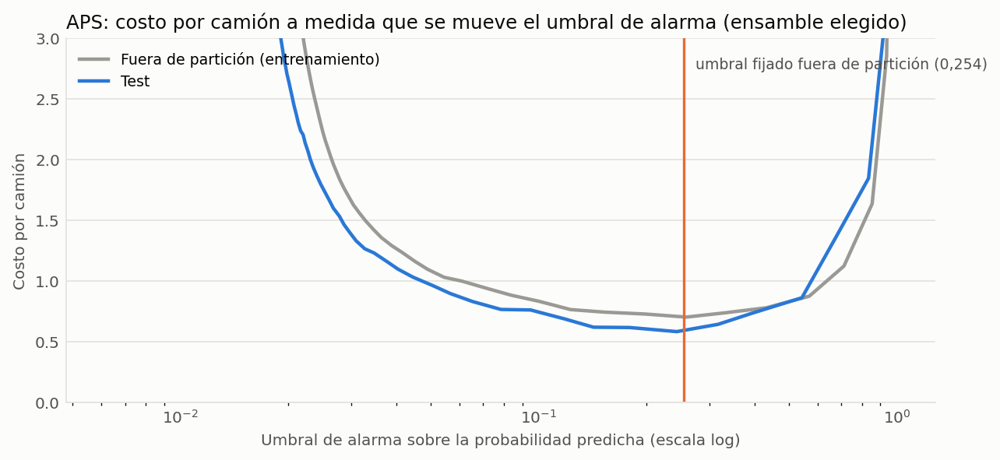

**El costo es plano alrededor del umbral elegido.** Fuera de partición se mantiene a menos de 10% de su mínimo para todo umbral entre 0,12 y 0,33, y el umbral fijado ahí (0,25) también queda en el fondo de la curva de test. Por eso reajustarlo mirando el test casi no gana nada.

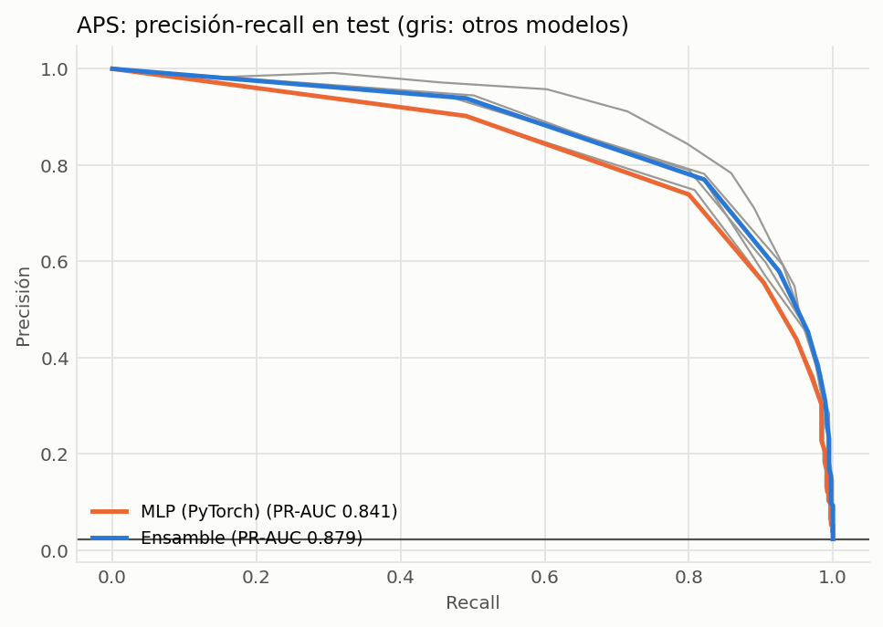

Con esta razón de costos solo importa el extremo de alto recall. El ensamble elegido detecta 368 de 375 fallas (98,1%) con una precisión de 39%. La mayoría de los modelos están cerca ahí, y la MLP queda atrás en toda la curva.

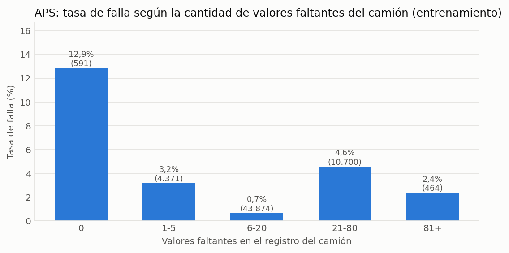

**Los valores faltantes traen señal.** Los camiones con el registro completo fallan el 12,9% de las veces (591 camiones), y los 43.874 con 6–20 faltantes fallan el 0,7%. Las variables están anonimizadas, así que no puedo saber por qué. El boosting usa los faltantes de forma nativa; el modelo lineal y la MLP los ven por columnas indicadoras y por la variable `n_missing`.

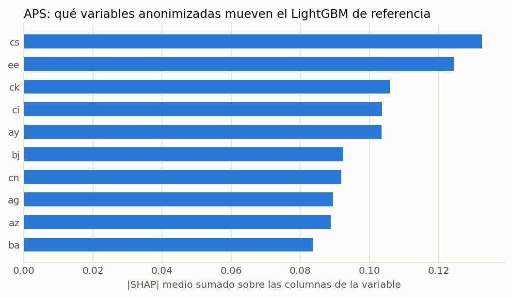

Las siete variables de histograma están entre las diez más importantes (|SHAP| medio de un LightGBM de referencia, sumado sobre las columnas de cada variable). La suma favorece a las variables con más columnas: un histograma tiene 10 bins más sus fracciones. Entre las features individuales, encabezan los contadores `ck_000`, `ci_000` y `bj_000`.

## 3. NASA C-MAPSS: vida útil restante

[C-MAPSS](https://www.nasa.gov/intelligent-systems-division/discovery-and-systems-health/pcoe/pcoe-data-set-repository/) es una **simulación** de turbinas de avión corridas hasta la falla, no datos de camiones. La incluyo porque es la vara pública estándar para la vida útil restante (RUL), con un puntaje asimétrico oficial. FD001–FD004 combinan una o seis condiciones de operación con uno o dos modos de falla.

Protocolo: la etiqueta de entrenamiento son los ciclos hasta la falla con techo de 125. El test se evalúa en el último ciclo observado de cada motor contra la RUL real, sin techo. Los sensores se estandarizan dentro de cada condición de operación (k-means sobre los tres ajustes). Los modelos tabulares ven el valor actual y la media, desviación y cambio en 10 ciclos de cada sensor. La CNN 1D y la GRU ven la secuencia cruda de los últimos 30 ciclos. La selección es validación cruzada de 5 particiones agrupada por motor; el ensamble es el promedio de los tres modelos con menor error de validación cruzada. Puntaje NASA: `exp(-d/13) - 1` si se adelanta, `exp(d/10) - 1` si se atrasa, `d` = predicción − verdad (menor es mejor).

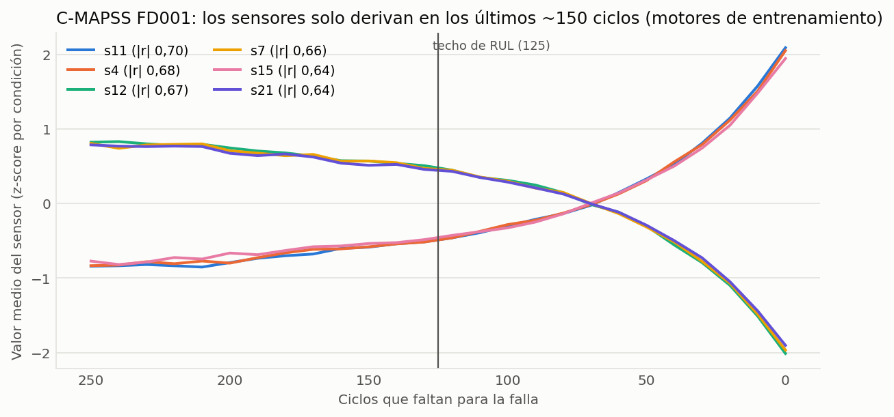

Por qué se recorta la etiqueta: en FD001 los sensores más informativos están casi planos hasta unos 150 ciclos antes de la falla y después derivan de forma sostenida. Un modelo no puede distinguir 250 ciclos restantes de 150, así que la etiqueta de entrenamiento se recorta en 125 y todas las filas del inicio de la vida piden la misma respuesta.

RMSE en test sobre el último ciclo de cada motor (en negrita, el modelo elegido):

| Subconjunto | Motores (entren. / test) | Constante | Ridge | Bosque aleatorio | LightGBM | XGBoost | CNN 1D | GRU | Ensamble | Elegido por CV (RMSE de CV, puntaje NASA en test) |
|---|---|---:|---:|---:|---:|---:|---:|---:|---:|---|
| FD001 (1 condición, 1 modo de falla) | 100 / 100 | 43,1 | 22,1 | 19,1 | 18,8 | 18,9 | 16,5 | **15,4** | 16,1 | GRU (13,4; 465) |
| FD002 (6 condiciones, 1 modo) | 260 / 259 | 54,1 | 30,9 | 27,9 | 27,6 | 27,6 | 31,8 | 29,7 | **27,4** | ensamble de GRU, LightGBM y XGBoost (15,7; 9.546) |
| FD003 (1 condición, 2 modos) | 100 / 100 | 45,1 | 21,9 | 19,3 | 17,9 | 18,1 | 16,2 | **13,7** | 14,3 | GRU (12,1; 382) |
| FD004 (6 condiciones, 2 modos) | 249 / 248 | 54,9 | 33,3 | 29,4 | 28,7 | 28,9 | 33,1 | 30,7 | **28,9** | ensamble de bosque aleatorio, LightGBM y XGBoost (16,5; 6.027) |


- **La GRU gana en los subconjuntos de una condición, los árboles en los de seis.** Con seis regímenes de operación la CNN 1D es el peor modelo en validación cruzada (21,4 y 20,5, detrás del 19,9 y 20,1 de Ridge), y la GRU queda detrás de los árboles en test. La estandarización por condición basta para las estadísticas de ventana, pero las secuencias crudas todavía traen cambios de régimen que las redes no absorben con esta cantidad de datos.
- **La validación cruzada subestima el error de test, sobre todo con seis condiciones** (15,7–16,5 contra 27,4–28,9 en los modelos elegidos). Los motores de test se cortan en un ciclo arbitrario, mientras que la validación cruzada evalúa todas las filas de motores que corren hasta la falla, incluidas las muchas filas del inicio de la vida que quedan en el techo de 125 y son fáciles.
- **El ensamble nunca queda lejos del mejor modelo**: a menos de 0,8 de RMSE del mejor puntaje en test en todos los subconjuntos, y es el mejor en FD002.
- **Las redes dejan de aprender temprano.** Su mejor época de validación está entre la 2 y la 17 de las 100 que corrieron, y la pérdida de validación sube después (figura de abajo). Es sobreajuste, no falta de entrenamiento.
- **Son features simples con hiperparámetros fijos**, no un modelo del estado del arte, y no los comparo con resultados publicados.


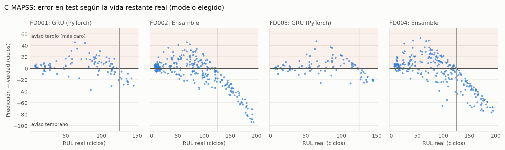

**Los subconjuntos de seis condiciones no son tanto más difíciles como dice su RMSE.** En FD002 y FD004, el 22–27% de los motores de test tiene más de 125 ciclos por delante. El modelo recortado los subestima en 42–46 ciclos en promedio, un aviso temprano que el puntaje NASA trata como el error barato. Esos motores concentran el 78% y el 70% del error cuadrático. En los motores dentro de sus últimos 125 ciclos el RMSE es 14,7 (FD002) y 18,4 (FD004), cerca del 14,5 y 12,9 de FD001 y FD003. En ese rango los errores tienden a atrasarse (+2 a +6 ciclos en promedio), la dirección cara.

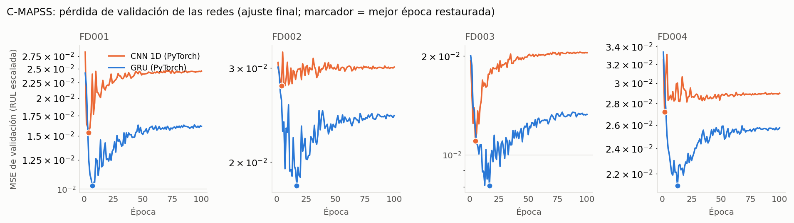

## 4. MetroPT-3: detección de anomalías sin etiquetas

[MetroPT-3](https://archive.ics.uci.edu/dataset/791) (UCI, CC BY 4.0) es la unidad de producción de aire del compresor de un tren de metro. Es el mismo tipo de sistema que el APS de un camión: aire comprimido para frenos y servicios. Tiene presiones, temperatura del aceite, corriente del motor y señales de válvulas de febrero a agosto de 2020, **sin etiquetas por fila**. El registro del operador lista cuatro fugas de aire, y contra ese registro se evalúan los detectores.

Dos cosas del archivo no coinciden con su descripción. Trae 1.516.948 filas, una lectura cada ~10 s, no 15 millones a 1 Hz. El registro de fallas numera sus filas "#1, #1, #3, #4" y fecha una reparación antes de su propia falla, que leo como un error de tipeo. Además hay 230 huecos de más de 10 minutos, 901 horas en total.

Protocolo: ventanas de 10 minutos (21 features: medias, dispersiones, presiones mínimas, fracción de tiempo activa de cada válvula, arranques del compresor). Los detectores se ajustan con el 1 de febrero – 15 de marzo, y el umbral de alarma es el percentil 99,5 del puntaje suavizado a 30 minutos en el 16–31 de marzo. La evaluación va del 1 de abril al 31 de agosto. Una fuga cuenta como detectada si hay alarma entre 2 h antes de su inicio reportado y su fin. Una falsa alarma es un episodio de alarma que empieza fuera de todas las zonas de falla. El nivel de azar es la misma serie de alarmas desplazada en el tiempo 500 veces: conserva cuánto alarma el detector pero no cuándo.

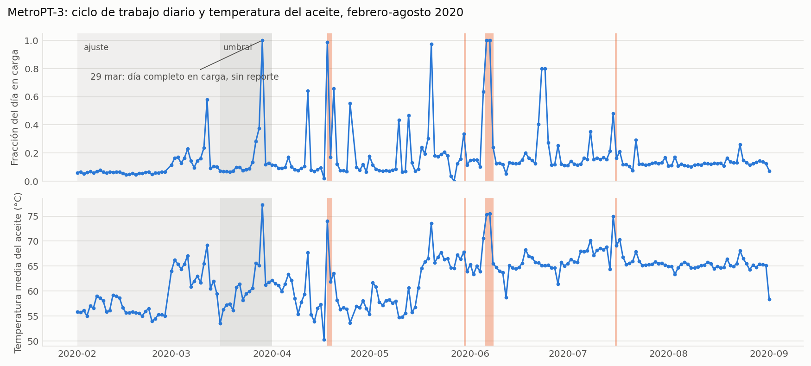

Antes de cualquier modelo: la fracción del día en que el compresor trabaja en carga está cerca de 6% en febrero y más o menos se duplica desde mediados de mayo, y la temperatura del aceite sube unos 10 °C con el verano. Un detector ajustado en invierno tiene que distinguir esa deriva estacional de una fuga. La referencia "sana" además incluye el 29 de marzo, un día completo en carga sin ninguna falla en el registro.

| Detector (vista de features) | Fugas detectadas (de 4) | Esperadas por azar | Falsas alarmas / semana | Tiempo normal en alarma |
|---|---:|---:|---:|---:|
| Presostato de baja que ya trae el equipo (regla) | 2 | 0,51 | 1,6 | 0,4% |
| z-score del ciclo de trabajo | 0 | 0,00 | 0,0 | 0,0% |
| Error de reconstrucción PCA | 4 | 2,08 | 7,0 | 19,7% |
| Isolation forest | 2 | 0,36 | 0,8 | 0,7% |
| Autoencoder (PyTorch, semilla 42) | 4 | 2,00 | 7,9 | 8,9% |
| PCA, features ajustadas por deriva | 4 | 2,66 | 12,0 | 27,7% |
| Isolation forest, ajustadas por deriva | 2 | 0,46 | 1,1 | 0,7% |
| Autoencoder, ajustadas por deriva | 4 | 2,21 | 6,7 | 20,5% |


**El autoencoder depende de su inicialización.** El mismo protocolo con seis semillas:

| Semilla | 42 | 1 | 2 | 3 | 4 | 5 |
|---|---:|---:|---:|---:|---:|---:|
| Fugas detectadas | 4 | 4 | 4 | 4 | 4 | 4 |
| Esperadas por azar | 2,00 | 2,03 | 1,83 | 2,04 | 1,72 | 1,69 |
| Falsas alarmas / semana | 7,9 | 13,7 | 7,9 | 10,6 | 5,9 | 5,5 |

Detecta las cuatro fugas en todas las corridas, pero sus falsas alarmas van de 5,5 a 13,7 por semana. Una sola corrida lo habría hecho ver mejor o peor de lo que es. (Una versión anterior de este pipeline construía la red antes de fijar la semilla, así que sus pesos dependían de lo que hubiera corrido antes en el proceso. Así llegó un 3,8 a un README anterior.)

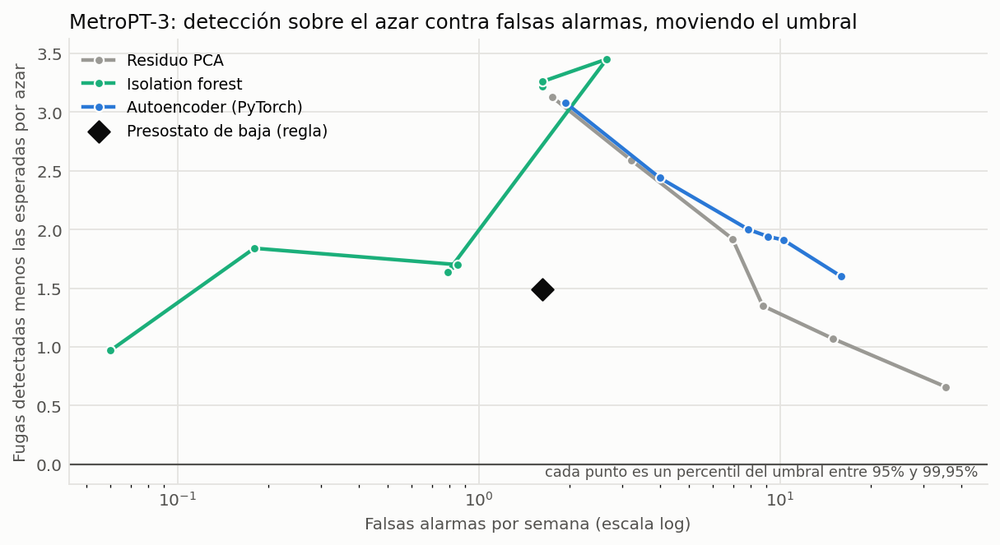

**Un solo umbral esconde el compromiso.** Mover el percentil del umbral entre 95% y 99,95% traza la curva de operación de cada detector. El isolation forest domina. Con el percentil 98 detectaría las cuatro fugas con 1,6 falsas alarmas por semana y 0,7 esperadas por azar, mientras que el percentil 99,5 fijado lo dejó en 2 de 4. En la tabla informo el percentil fijado, porque elegirlo desde esta curva sería ajustar con el periodo de evaluación. Un despliegue debería fijarlo en una ventana de validación posterior.

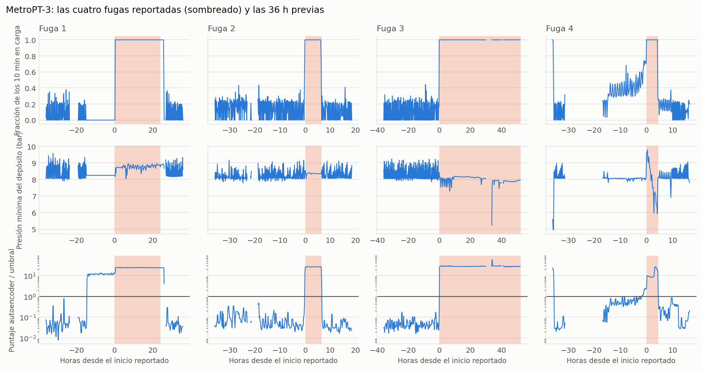

**Cómo se ven las fugas.** Las fugas 2 y 3 empiezan de golpe. El compresor salta de cerca de 15% a 100% de carga sin ningún cambio en las horas previas, así que ningún detector puede adelantarse. La fuga 4 tiene un precursor de 15 horas: la fracción en carga se duplica con creces (de 0,18 a 0,42 en promedio) y el autoencoder cruza su umbral 1,8 h antes del inicio reportado. La fuga 1 viene precedida por unas 15 horas con el compresor apagado. El autoencoder lo marca 14,5 h antes, pero es un estado inusual, no una firma de fuga reconocible.

- **El presostato de baja que ya trae el equipo detecta 2 de 4, tarde.** Salta 34 h y 3 h después del inicio reportado de las fugas 3 y 4. Esa es la base que cualquier modelo tiene que superar.
- **Restar la mediana de los 7 días anteriores (ajuste por deriva) no ayudó.** Esperaba que absorbiera la subida de verano del ciclo de trabajo y de la temperatura del aceite. Dejó al PCA y al autoencoder 20–28% del tiempo normal en alarma, y lo informo tal como salió.
- **El z-score del ciclo de trabajo está ciego** porque su periodo de referencia incluye el 29 de marzo, un día al 100% de carga (ver el hallazgo 4). Mantuve el protocolo fijado en vez de mover la referencia después de ver el periodo de evaluación.


---

## Límites

- **Nada de esto son datos mineros.** Camiones de carretera, un compresor de metro y turbinas simuladas comparten la estructura del mantenimiento de una flota minera (contadores de uso, fallas raras y caras, censura), pero no tengo evidencia de que los números se transfieran a una faena.
- **Los factores de escala de SCANIA son una inferencia.** Los deduzco de los datos. Son consistentes entre los bins de cada variable, pero el dataset no los documenta por conjunto.
- **Pocas fallas.** 136 y 142 camiones SCANIA que fallan, 375 fallas APS, 4 fugas en MetroPT. Los intervalos son anchos, y en MetroPT-3 cuatro eventos no alcanzan para ordenar detectores con confianza.
- **Las matrices de costos son las de los retos.** Los ahorros valen lo que valgan esas cifras. El análisis de sensibilidad de SCANIA y la página interactiva existen para eso.
- **Variables anonimizadas** (SCANIA, APS), así que no hay diagnóstico físico.
- **Hiperparámetros fijos.** No ajusté nada, así que cada modelo probablemente podría mejorar algo. La comparación es entre familias con el mismo presupuesto, no entre sus mejores versiones posibles.
- **Las redes son deterministas en el mismo hardware** (semillas fijas, cuBLAS y cuDNN deterministas), pero CPU y GPU dan números levemente distintos. Los análisis por semilla muestran que la semilla mueve los resultados más que eso.

## Reproducir

```bash
python -m venv .venv && source .venv/bin/activate   # Windows: .venv\Scripts\activate
pip install -r requirements.txt                     # PyTorch solo CPU: pip install torch --index-url https://download.pytorch.org/whl/cpu

python -m src.cli download    # ~2,1 GB en data/raw (verificados por hash)
python -m src.cli all         # scania, aps, cmapss, metropt, figures, site
pytest                        # pruebas con datos sintéticos; las que necesitan un dataset se omiten si falta
```

Tiempos en una CPU de 16 núcleos con una RTX 4060 Ti: SCANIA ~1 h (7 familias × 3 semillas; CatBoost toma ~30 min), APS ~12 min, C-MAPSS ~1,5 h (cuDNN determinista es más lento), MetroPT-3 ~10 min (seis semillas del autoencoder). Cada paso corre por separado: `python -m src.cli scania`, etc.

Salidas: `reports/<dataset>/results.json`, figuras en `reports/figures/{en,es}/` y la página en `docs/`. Los modelos y checkpoints van a `data/processed/models/`, que no se versiona.

## API

`POST /score` recibe el historial de lecturas de un camión SCANIA y sus `Spec_0…Spec_7`, y devuelve las probabilidades por clase, el costo esperado de cada acción y la recomendada. Exige el header `X-API-Key` y limita las solicitudes por IP. `GET /health` es abierto.

```bash
export RISK_API_KEY=change-me
uvicorn src.api.main:app
```

El modelo es el clasificador SCANIA elegido, con features invariantes a la escala (`python -m src.demo fetch-model` lo descarga del release; `python -m src.cli scania` lo reentrena). Sus probabilidades pasan por la calibración isotónica ajustada en camiones retenidos del entrenamiento, la que se evalúa arriba; `probabilidad_algun_riesgo_cruda` entrega el valor sin calibrar. El `Dockerfile` arma una imagen autocontenida de este servicio.

## Estructura

```
src/cli.py                      punto de entrada único (download, scania, aps, cmapss, metropt, figures, site, all)
src/data/                       un cargador por dataset: descarga con verificación SHA-256, lectura, etiquetas
src/features/engineering.py     features por lectura de SCANIA, incluido el subconjunto invariante a la escala
src/models/zoo.py               interfaz común para LR, RF, LightGBM, XGBoost, CatBoost y la MLP
src/models/nets.py              bucle de entrenamiento PyTorch: mín. 100 épocas, parada temprana, checkpoints
src/models/evaluation.py        umbral de costo mínimo, intervalos bootstrap
src/models/train_pipeline.py    SCANIA: diagnóstico de escala, clasificadores, tiempo hasta la falla, supervivencia, SHAP
src/models/aps_pipeline.py      APS: catálogo de modelos con validación cruzada bajo el costo del reto
src/models/rul_estimator.py     modelos de C-MAPSS (tabulares y de secuencia)
src/models/rul_benchmark.py     benchmark C-MAPSS FD001-FD004
src/models/metropt_pipeline.py  MetroPT-3: ventanas, detectores, evaluación por eventos, nivel de azar
src/models/sequence_scania.py   SCANIA: GRU sobre el historial de lecturas de cada camión
src/models/scania_analysis.py   SCANIA: supervivencia, anticipación, curvas, desglose del costo, bootstrap pareado
src/models/make_figures.py      figuras de resultados, en inglés y español
src/models/analysis_figures.py  figuras de análisis (exploración, diagnóstico, robustez), en inglés y español
src/models/cost_decision.py     decisión de costo esperado mínimo con la matriz de SCANIA
src/models/calibration.py       tablas de calibración, Platt, sensibilidad al costo de la visita
src/site.py                     genera la página de GitHub Pages (docs/, generada)
src/api/main.py                 servicio FastAPI
src/demo.py                     modelo publicado, camiones de ejemplo, puntuación sin entrenar
examples/                       cuatro camiones reales de validación como cuerpos de /score
notebooks/quickstart.ipynb      recorrido de cinco minutos (lo genera notebooks/build_quickstart.py)
Dockerfile                      la API con el modelo publicado
tests/                          pruebas unitarias con datos sintéticos y chequeos de consistencia de los resultados
```

Una versión anterior de este repositorio corría sobre un generador de datos sintéticos y tenía una red multitarea en PyTorch y un dashboard en Streamlit. Los quité al pasar a datos reales; siguen en el historial de git.

## Licencia y datos

Código: MIT. Los datos no se redistribuyen aquí (cada cargador los descarga desde la fuente):

- SCANIA Component X: © Scania CV AB, CC BY 4.0 (los cuatro camiones de `examples/` vienen de su conjunto de validación). Lindgren et al., *SCANIA Component X dataset: a real-world multivariate time series dataset for predictive maintenance*, [arXiv:2401.15199](https://arxiv.org/abs/2401.15199).
- APS Failure at Scania Trucks: © Scania CV AB, GNU GPL v3, UCI Machine Learning Repository.
- NASA C-MAPSS: Saxena et al., *Damage propagation modeling for aircraft engine run-to-failure simulation*, PHM 2008. NASA Prognostics Center of Excellence.
- MetroPT-3: Veloso et al., *The MetroPT dataset for predictive maintenance*, Scientific Data 9, 764 (2022). CC BY 4.0, UCI Machine Learning Repository.
