# Predictive maintenance on real heavy-vehicle data

[English ] | [[Español](README.es.md) ]


Two real Scania truck datasets, the air compressor of a metro train and NASA's turbofan benchmark. Each one is a different predictive-maintenance task: a cost-weighted risk decision, a cost-weighted failure classifier, remaining useful life, and anomaly detection without labels. They all follow one protocol: six model families per task, every model selected **without looking at the test set**, and every headline number reported with a bootstrap interval or a chance level.

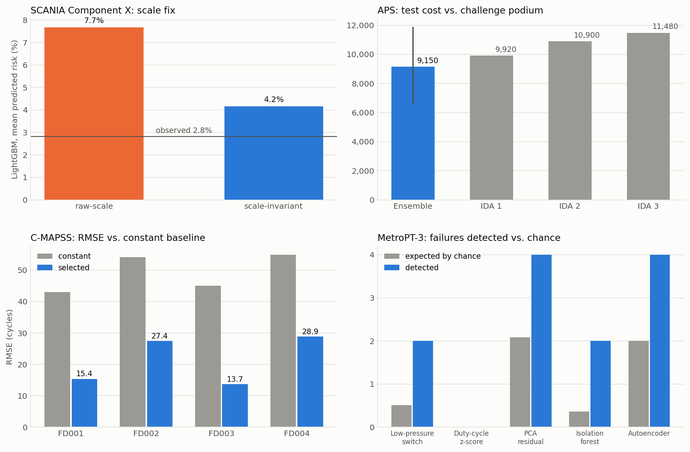

**[Interactive page](https://rxyxs.github.io/heavy-truck-predictive-maintenance/)**: move the cost of a workshop visit and watch the SCANIA decision, and its saving, change for the old and the new model.

## Results at a glance

| Dataset | Task | Data | Model picked without the test set | Result on the test set |
|---|---|---|---|---|
| [SCANIA Component X](#1-scania-component-x-risk-decision-under-a-cost-matrix) | 5-class failure window → maintenance action | real, 33,641 trucks | MLP on scale-invariant features | **24.2%** lower official cost (95% CI 13.8–33.8); 37.0% on validation |
| [APS Failure at Scania Trucks](#2-aps-failure-at-scania-trucks-cost-weighted-classification) | air-pressure-system failure, yes/no | real, 76,000 trucks | mean of LightGBM, XGBoost and CatBoost | cost **9,150** (95% CI 6,620–11,850); challenge winner: 9,920 |
| [NASA C-MAPSS](#3-nasa-c-mapss-remaining-useful-life) | remaining useful life | simulated, 1,416 engines | picked per subset by grouped CV (GRU or ensemble) | RMSE **15.4 / 27.4 / 13.7 / 28.9** on FD001–FD004; a constant scores 43–55 |
| [MetroPT-3](#4-metropt-3-anomaly-detection-without-labels) | air-leak detection, no labels | real, 1.5 M readings | five detectors reported side by side | autoencoder: **4 of 4** leaks in all 6 seeds (~2 expected by chance), 5.5–13.7 false alarms/week |

## What I found

1. **The SCANIA Component X splits are on different scales.** Every anonymised variable is multiplied by its own factor (×0.16 to ×3.9), and the factor changes between training, validation and test. A classifier separates training from validation readouts with AUC 1.00. The same LightGBM with the same hyperparameters overstates the risk 2.7 to 6.3 times on raw-scale features, and only 1.5 times on features that cancel the factor (4.2% predicted against 2.7% observed on validation). The cost of a workshop visit at which its saving runs out rises from ×1.65 to ×4.14 on validation and from ×1.90 to ×2.90 on test. At the benchmark's own cost the fix does not raise the test saving (26.2% against 28.5%). What it buys is a policy that loses far less when visits get expensive: at ×10, −12% instead of −138% on validation and −45% on test.
2. **Validation drawn from the training split cannot see that, and cannot pick a winner either.** On held-out training trucks the raw-scale model looks like the best of all (5,105 expected cost per 1,000 trucks). Only the differently scaled splits expose it, and I found it with adversarial validation, which uses the features of validation and test but never their labels. Among the scale-invariant models the held-out scores are within training noise. Retrained with five more seeds, the MLP scores 5,237–5,380 per 1,000 trucks and XGBoost 5,085–5,277. The MLP was picked because its seed 42 happened to be its best (5,116), a winner's curse. On test, XGBoost saves 30.6–33.3% across its six seeds and the MLP 21.4–26.7%.
3. **On APS the threshold transfers.** The cost-minimising threshold is fixed on out-of-fold training predictions. Re-tuning it on the test set, which is not a valid result, would lower the ensemble's cost by only 60 (9,150 → 9,090), so the reported number is not an artefact of where the threshold landed.
4. **The "healthy" reference period of MetroPT-3 is not healthy.** On 29 March the compressor ran under load all day, the signature of a leak, with no failure in the company's log. A detector whose alarm threshold is calibrated on that period goes blind. The duty-cycle z-score raises zero alarms in five months, including during the four reported leaks.
5. **Neural networks win on simple sequences and not on tabular features.** On the single-condition C-MAPSS subsets a GRU over the last 30 cycles is the best model (test RMSE 15.4 and 13.7, against 17.9–18.8 for the best tree). With six operating conditions it falls behind the trees (29.7 and 30.7 against 27.6 and 28.7), and the 1D-CNN is the worst model there in cross-validation. On the two tabular Scania problems the MLP reaches its best validation loss within 3 to 8 epochs, and on test it trails the best boosting model in both. Every network ran at least 100 epochs with the best checkpoint restored, so this is not undertraining.

## Architecture

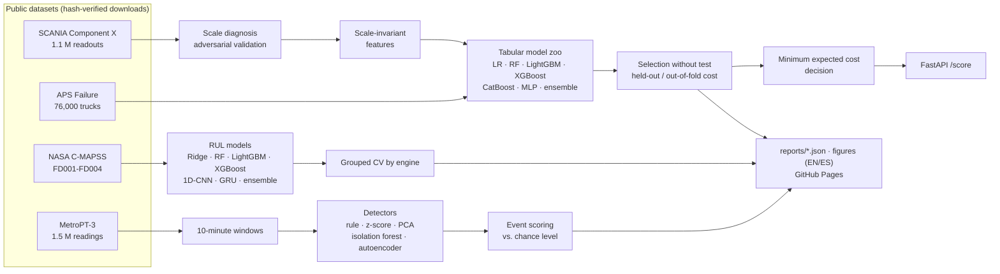

## Shared protocol

- **No selection on the test set.** SCANIA picks on held-out training trucks, APS on out-of-fold training predictions, C-MAPSS on cross-validation grouped by engine. MetroPT-3 has no labels to select with, so all five detectors are reported. The test set is looked at once, with every model.
- **Early stopping on a separate set.** Boosting models and networks stop on data that is neither the scored fold nor the test set.
- **Neural networks** (PyTorch): at least 100 epochs, early stopping by patience after that, best checkpoint restored and saved (`src/models/nets.py`). They run on the GPU when one is available.
- **Uncertainty.** Bootstrap intervals by truck for costs and savings, and paired bootstrap between models. For MetroPT-3, a chance level: the same alarm series shifted in time 500 times. The networks that decide a result (the SCANIA MLP, the MetroPT autoencoder) are also retrained with several seeds.
- **Hyperparameters are fixed up front** and are the same across datasets unless stated. Nothing is tuned on validation or test.

---

## 1. SCANIA Component X: risk decision under a cost matrix

[SCANIA Component X](https://researchdata.se/en/catalogue/dataset/2024-34) (CC BY 4.0) is the dataset of the IDA 2024 Industrial Challenge: 23,550 training trucks (2,272 repairs of an anonymised engine component), and 5,046 validation and 5,045 test trucks with **one randomly chosen readout each**, to mimic standing at "today". The label is the time left before the repair: 0 = more than 48 time units, 1–4 = 24–48, 12–24, 6–12 or 0–6. The challenge scores each recommendation with an asymmetric matrix. An unnecessary check costs 7–10 and a missed failure 200–500, so the reference to beat is "recommend nothing": 57,400 on validation and 56,100 on test.

<details>
<summary>Cost matrix</summary>

| | recommend 0 | 1 | 2 | 3 | 4 |
|---|---|---|---|---|---|
| **healthy (0)** | 0 | 7 | 8 | 9 | 10 |
| **fails in 24–48 (1)** | 200 | 0 | 7 | 8 | 9 |
| **fails in 12–24 (2)** | 300 | 200 | 0 | 7 | 8 |
| **fails in 6–12 (3)** | 400 | 300 | 200 | 0 | 7 |
| **fails in 0–6 (4)** | 500 | 400 | 300 | 200 | 0 |

</details>

**Features.** All 105 operational columns are cumulative counters and histogram bins, so the features are usage rates, histogram fractions and their recent change, computed from each truck's past only. A test recomputes every feature on truncated histories to check that nothing looks ahead. The decision is the action with the **lowest expected cost** under the model's class probabilities, not the most probable class.

### The hidden scale shift

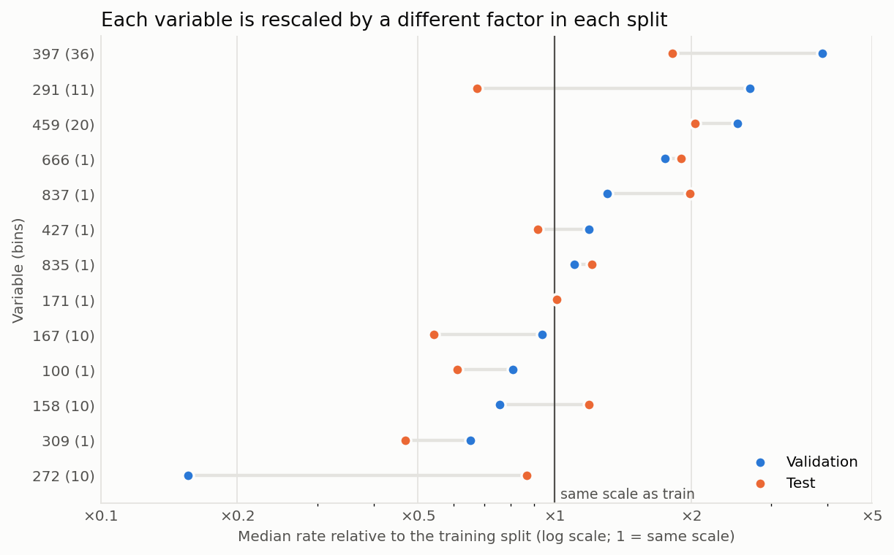

Comparing the median usage rate of each variable across splits shows a factor per variable that is consistent across its histogram bins and different in each split. Variable 272 is at ×0.16 of its training scale in validation and ×0.87 in test, and variable 397 at ×3.9 and ×1.8. The paper that describes the dataset says some perturbations "like scaling" were applied; it does not say they differ between splits.

| Adversarial validation (LightGBM, 5-fold AUC) | train vs. validation | train vs. test | validation vs. test |
|---|---:|---:|---:|
| All 512 readout features | 1.00 | 1.00 | 1.00 |
| Scale-invariant readout features only (302) | 0.82 | 0.81 | 0.67 |

Rates inherit the factor. Histogram fractions and the ratio of the recent to the lifetime rate (`rel_rate_*`) cancel it. What still separates the splits once the scale is gone is mostly `time_step`:

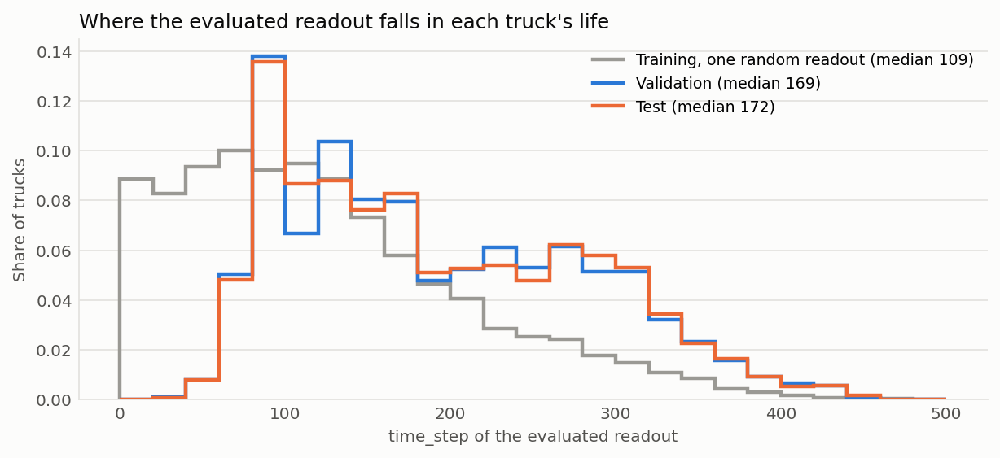

The dataset describes the validation and test readout as "selected randomly among all readouts" of each truck. It is not uniform. A random training readout falls before time 60 for 26.5% of trucks, but the validation and test readouts do so for 0.9%, and their median sits at 169–172 time units against 109. The model trains on early-life readouts it is never evaluated on. The selection weights (1 / readouts per truck) assume the documented protocol, so they do not correct for this either.

### Seven classifiers, picked on held-out training trucks

Training uses every risky readout plus 5% of the healthy ones (re-weighted ×20), split by truck into 70% fit, 15% early stopping and 15% selection. The selection score is the expected official cost on the selection trucks, with each readout weighted by 1 / (readouts of its truck), which is exactly the one-random-readout protocol of validation and test.

| Model | Held-out cost / 1,000 trucks | Validation saving (95% CI) | Test saving (95% CI) | Mean predicted risk (val. / test) | Saving runs out at (val. / test) |
|---|---:|---:|---:|---:|---:|
| Logistic regression | 5,254 | 31.8% (22.2–40.8) | 21.6% (11.3–30.5) | 3.5% / 3.4% | ×4.14 / ×2.35 |
| Random forest | 7,756 | 21.0% (5.8–32.4) | 18.2% (3.7–30.1) | 17.3% / 17.1% | ×1.29 / ×1.24 |
| LightGBM | 5,385 | 31.4% (22.6–40.5) | 26.2% (16.6–34.7) | 4.2% / 4.1% | ×4.14 / ×2.90 |
| XGBoost (picked in a CPU run) | 5,131 | 41.5% (32.5–50.5) | 30.6% (19.7–39.5) | 3.6% / 3.6% | ×6.78 / ×4.60 |
| CatBoost | 5,296 | 37.6% (27.8–46.1) | 28.1% (17.2–36.7) | 3.2% / 3.2% | ×7.81 / ×3.12 |
| **MLP, PyTorch (selected)** | **5,116** | **37.0% (26.9–46.0)** | **24.2% (13.8–33.8)** | **3.5% / 3.4%** | **×5.68 / ×2.04** |
| Ensemble (mean of the 3 GBMs) | 5,132 | 37.9% (28.8–46.4) | 28.9% (18.1–38.0) | 3.7% / 3.6% | ×6.10 / ×3.47 |
| *LightGBM on raw-scale features (previous version)* | *5,105* | *28.7% (16.6–37.9)* | *28.5% (18.0–37.3)* | *16.9% / 7.7%* | *×1.65 / ×1.90* |

Observed failure rate: 2.7% on validation and 2.8% on test. "Saving runs out at" is the cost of an unnecessary visit, as a multiple of the benchmark's 7–10, above which the saving falls below 1%.

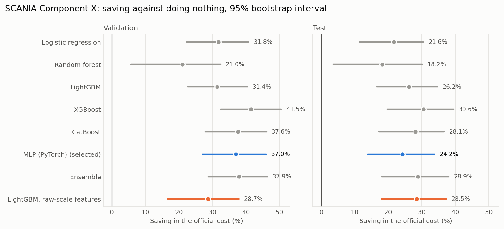

- **The pick is a coin toss among the top three.** On held-out trucks the MLP, XGBoost and the ensemble are within 16 points per 1,000 trucks, and the next section shows that this is less than either model moves between seeds. I report the pick as the fixed rule made it instead of re-running until it looked better on test. On validation and test the intervals of the good models overlap: with 136 and 142 failing trucks they cannot be told apart with confidence.
- **The random forest is badly calibrated** (17% predicted risk). Its leaves average the re-weighted training rows, and a leaf made only of risky rows predicts 100% risk. It is the worst model here for that reason, not for lack of ranking power (validation AUC 0.72).
- **The raw-scale model's test saving looks fine** (28.5%), which is how the problem hid in the previous version of this repository. Its probabilities are not credible, and the next figure shows what that costs, comparing it with the same LightGBM on invariant features.

### How much of the ranking is noise

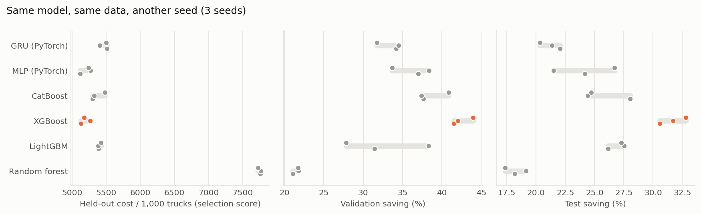

The MLP and XGBoost retrained with five more seeds each, same rows, same features:

| | Held-out cost / 1,000 trucks | Validation saving | Test saving |
|---|---:|---:|---:|
| XGBoost, 6 seeds | 5,085–5,277 (mean 5,184) | 37.3–44.0% | 30.6–33.3% |
| MLP, 6 seeds | 5,116–5,380 (mean 5,280) | 33.7–38.4% | 21.4–26.7% |

Seed 42 is the MLP's best of six on held-out trucks, and that is why the rule picked it: with one seed per model, the selection rewards whichever model drew the luckiest initialisation. Averaged over seeds, the same held-out score would have picked XGBoost, which is also the more stable model on test. I did not switch the reported pick, because that decision would be made after seeing the test results; for a deployment I would select on the mean over seeds from the start.

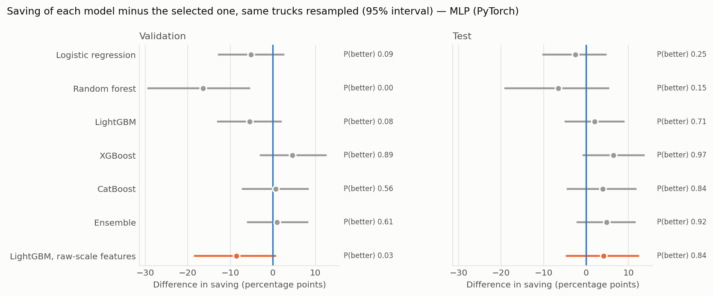

The paired bootstrap resamples the same trucks for every model, which removes the noise the models share. On test, XGBoost beats the selected MLP in 97% of resamples (+6.5 points, 95% interval −0.6 to +13.6) and the ensemble in 92%. On validation the margins are smaller (XGBoost +4.6 points, 89%).

### Robustness to the cost assumption

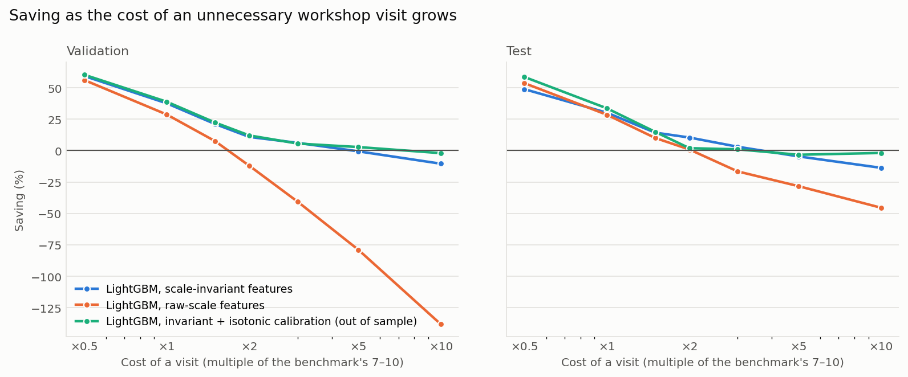

With credible probabilities the minimum-expected-cost policy should never do worse than doing nothing. It should simply alarm less as visits get more expensive. Same model, same hyperparameters, only the features change. On raw-scale features LightGBM loses money as soon as a visit costs about twice the benchmark's, and reaches −138% (validation) and −45% (test) at ×10. On invariant features it stays above zero up to ×3 and ends at −12% at ×10, because it still overstates the risk in its top bands. At ×1 on test the raw-scale model saves slightly more (28.5% against 26.2%), so the fix buys robustness to the cost assumption, not a better score on the benchmark's own matrix.

### Where the cost comes from, and how early a failure shows

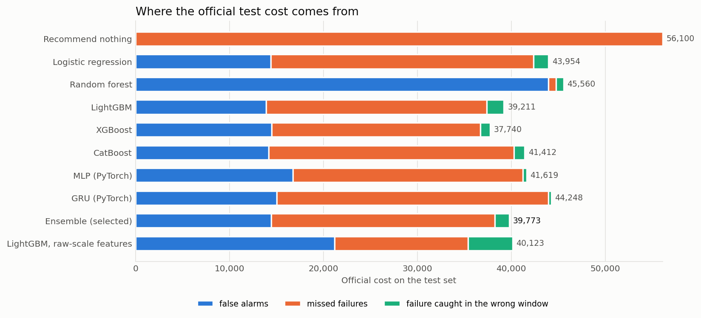

Doing nothing costs 56,100 on test, all of it missed failures. Every scale-invariant model except the random forest removes roughly half of that and adds 12,000–15,000 of false alarms, and missed failures remain the largest share of what is left (23,500 of 38,955 for XGBoost). The raw-scale model gets its similar total differently: it alarms more (21,207 in false alarms) and misses less (14,200), the behaviour of a model that overstates risk. The random forest alarms almost everyone (43,703 in false alarms).

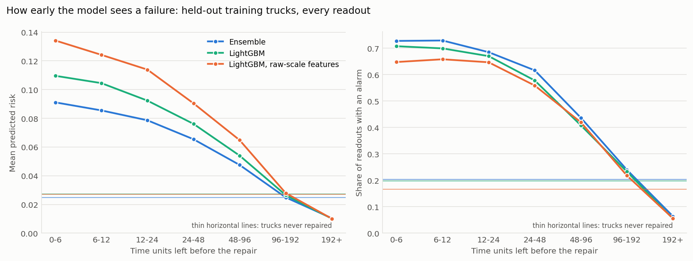

On every readout of held-out training trucks, the share that gets an alarm rises steadily as the repair approaches. For the selected MLP it is 13% more than 192 units out, 48% at 48–96 units and 73% in the last 6 units, against 22% for trucks that are never repaired. The signal is a slow drift that starts 100–200 time units before the repair, much earlier than the 48-unit window the challenge scores. That is why the model cannot tell the windows apart and almost always recommends class 4.

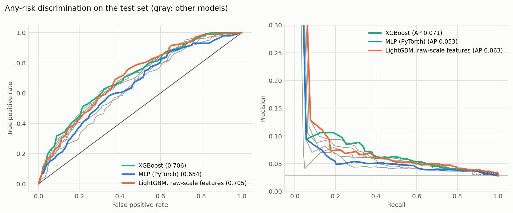

Ranking power is modest and similar across models: any-risk ROC AUC 0.70–0.71 on test for XGBoost, LightGBM, the ensemble and the raw-scale model, and 0.65 for the selected MLP. Average precision is 0.05–0.07 against a base rate of 0.028.

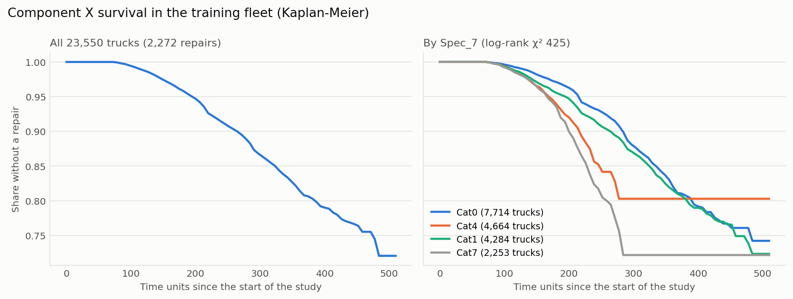

Over the study, 9.6% of training trucks had component X repaired. Of the eight anonymised specifications, `Spec_7` separates survival most (log-rank χ² 425, p < 10⁻⁸⁰). Its category Cat1 has a 14.1% repair rate against 7.0% for Cat4. `Spec_5` does not separate it at all (p = 0.36). `Spec_7` is also the second most important feature of the time-to-failure model below.

<details>
<summary>What the decision looks like, time to failure, survival and SHAP</summary>

**Decision (selected MLP, minimum expected cost).** It alarms 85 of 136 failing trucks on validation (62%) and 74 of 142 on test (52%), and 31% and 30% of healthy trucks. More than 99% of its alarms are class 4, so in practice it is an "alarm / no alarm" switch and does not resolve the intermediate windows. Any-risk ROC AUC: 0.722 on validation and 0.654 on test (XGBoost: 0.744 and 0.706). Platt slope of its risk: 0.66 fitted on validation and 0.43 on test, where 1 would be perfect calibration.

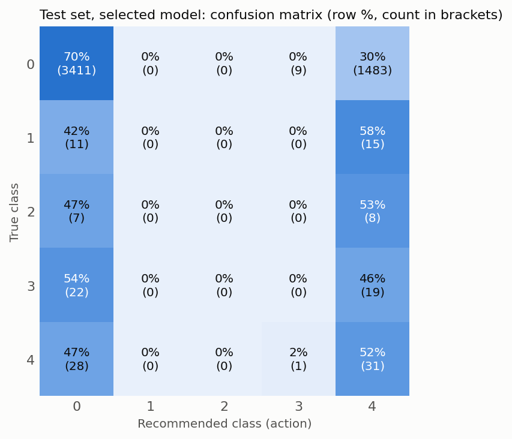

**Time to failure** (LightGBM on `log1p`, trucks that failed, 568 held-out trucks): MAE 45.5 against 67.1 for the median, and 39.5 against 80.4 within 48 units of the repair. It beats the baseline but cannot locate the failure inside a 48-unit window, and it is conditional on the truck failing.

**Survival from a landmark at 50 time units** (23,333 trucks at risk; early usage + specifications; held-out C-index):

| Model | C-index |
|---|---:|
| Cox proportional hazards | 0.697 |
| Weibull AFT | 0.690 |
| Random survival forest | **0.719** |
| Cox, specifications only | 0.651 |
| Cox, early usage only | 0.665 |

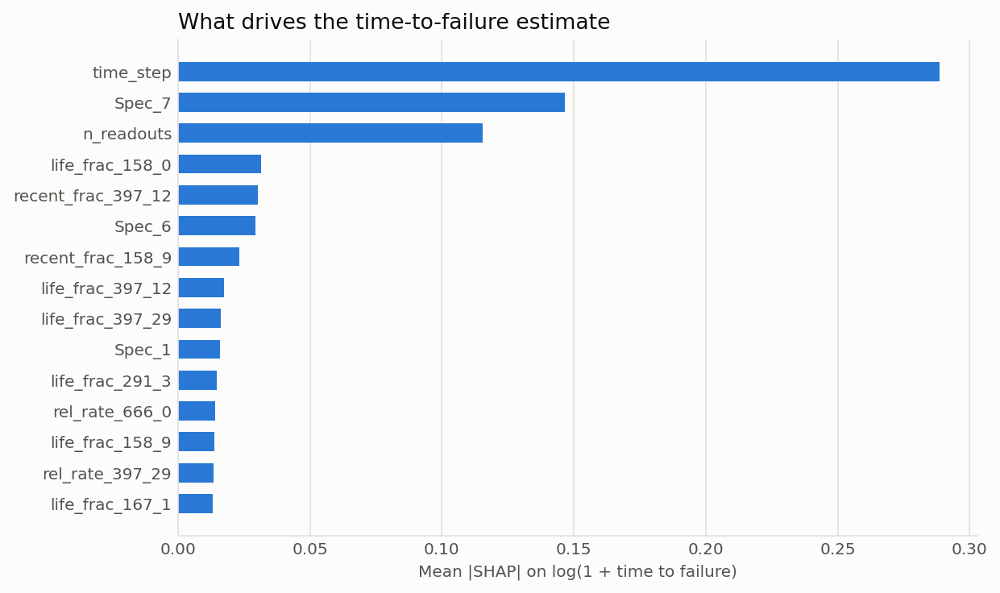

The time-to-failure model leans on how long the truck has been running (`time_step`, `n_readouts`) and on its configuration (`Spec_7`). The operating variables are anonymised, so there is no physical diagnosis.

</details>

<details>
<summary>Calibration: mean predicted risk over observed, every model</summary>

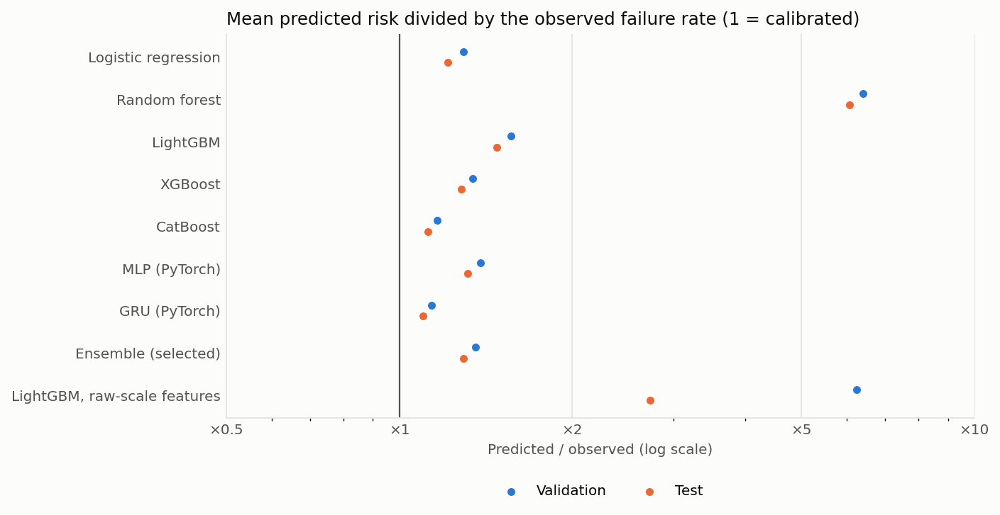

</details>

## 2. APS Failure at Scania Trucks: cost-weighted classification

[APS Failure at Scania Trucks](https://archive.ics.uci.edu/dataset/421) (UCI, GPL-3.0, © Scania CV AB) is the dataset of the IDA 2016 challenge. Each truck is one row of 170 anonymised counters and histograms, and the positive class is a failure of a component of the air pressure system (brakes, gear changes). Training has 60,000 trucks (1,000 failures, 1.7%) and test 16,000 (375, 2.3%), with 8.3% missing values. Cost = 10 × unnecessary checks + 500 × missed failures. The file that ships with the data lists the podium: **9,920 / 10,900 / 11,480**.

Protocol: 5-fold stratified cross-validation on training (class-balanced weights; boosting and the MLP stop early on 15% of each training fold). The alarm threshold is the one that minimises the cost on the out-of-fold predictions. The test prediction is the mean of the five fold models. The pick is the lowest out-of-fold cost.

| Model | Out-of-fold cost (60,000 trucks) | Test cost (95% CI) | False alarms | Missed | Test PR-AUC |
|---|---:|---:|---:|---:|---:|
| Logistic regression | 51,570 | 11,310 (8,439–14,720) | 631 | 10 | 0.844 |
| Random forest | 42,120 | 9,400 (6,840–12,070) | 590 | 7 | 0.899 |
| LightGBM | 43,050 | 10,290 (7,040–13,680) | 479 | 11 | 0.881 |
| XGBoost | 44,140 | 10,340 (7,250–13,630) | 534 | 10 | 0.871 |
| CatBoost | 42,970 | 9,670 (7,370–12,270) | 667 | 6 | 0.876 |
| MLP (PyTorch) | 54,140 | 12,610 (9,690–16,080) | 761 | 10 | 0.841 |
| **Ensemble (selected)** | **42,080** | **9,150 (6,620–11,850)** | **565** | **7** | 0.879 |

Doing nothing costs 187,500 and alarming every truck 156,250.

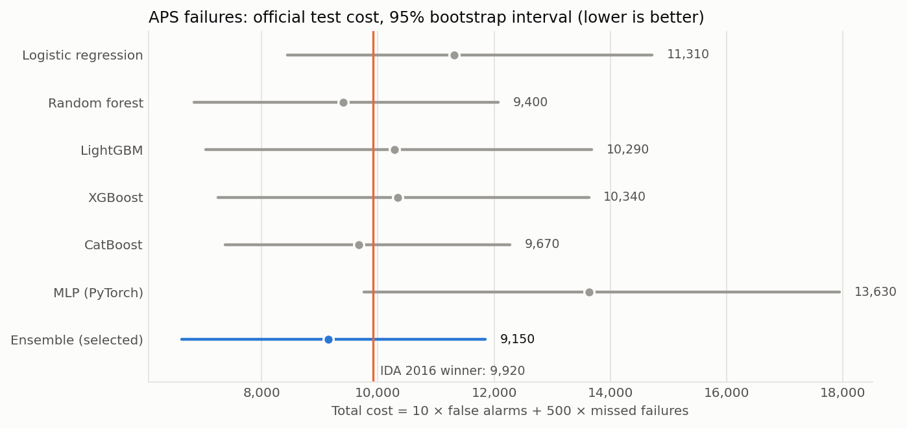

The selected ensemble's point estimate is below the challenge winner's, but the winner's 9,920 sits inside its interval, so I read it as on par, not better. The contestants did not have the test labels either. The MLP reaches its best early-stopping loss between epochs 3 and 8 of the 100 it ran in each fold, and is the weakest model. Many published results on this dataset tune the threshold on the test set, which is not a valid result. Doing that here would lower the ensemble's cost by only 60.

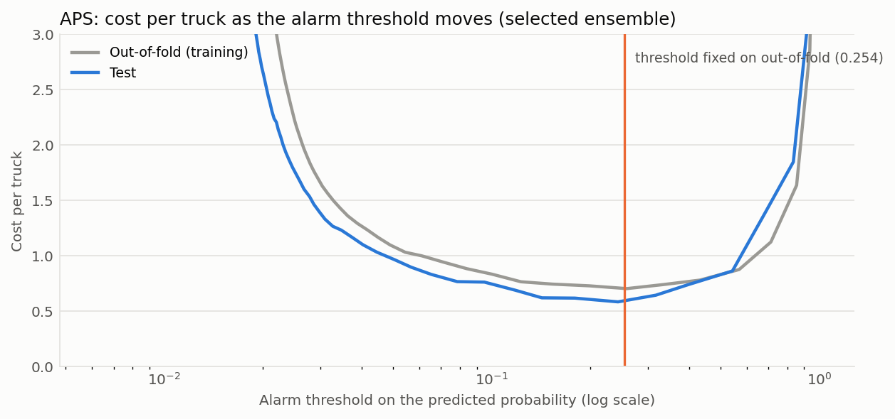

**The cost is flat around the chosen threshold.** Out-of-fold, it stays within 10% of its minimum for every threshold between 0.12 and 0.33, and the threshold fixed there (0.25) also sits at the bottom of the test curve. That is why re-tuning on test buys almost nothing.

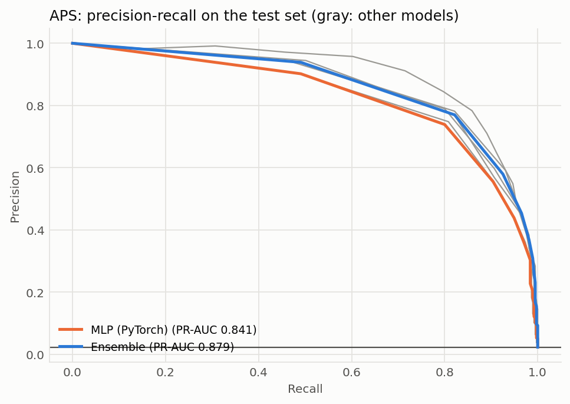

At this cost ratio only the high-recall end matters. The selected ensemble catches 368 of 375 failures (98.1%) at a precision of 39%. Most models are close there, and the MLP falls behind over the whole curve.

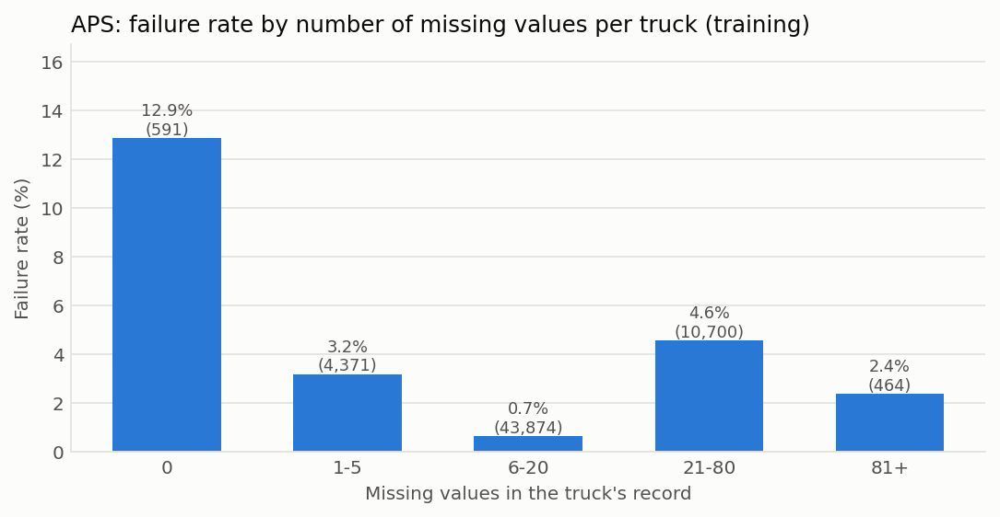

**Missing values carry signal.** Trucks with a complete record fail 12.9% of the time (591 trucks), and the 43,874 with 6–20 missing values fail 0.7%. The variables are anonymised, so I cannot tell why. The boosting models use missingness natively; the linear model and the MLP see it through indicator columns and the `n_missing` feature.

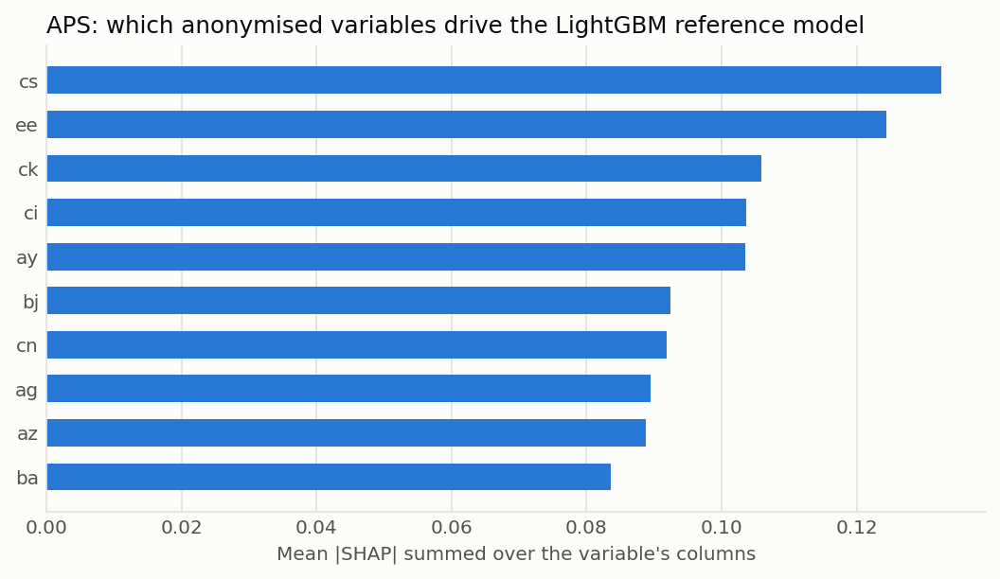

All seven histogram variables are among the ten most important (mean |SHAP| of a LightGBM reference model, summed over each variable's columns). The sum favours variables with more columns: a histogram has 10 bins plus their shares. Among single features, the counters `ck_000`, `ci_000` and `bj_000` lead.

## 3. NASA C-MAPSS: remaining useful life

[C-MAPSS](https://www.nasa.gov/intelligent-systems-division/discovery-and-systems-health/pcoe/pcoe-data-set-repository/) is a **simulation** of aircraft turbofan engines run to failure, not truck data. I include it because it is the standard public yardstick for remaining useful life (RUL), with an official asymmetric score. FD001–FD004 combine one or six operating conditions with one or two fault modes.

Protocol: the training label is cycles to failure capped at 125. The test set is scored on the last observed cycle of each engine against the true RUL, uncapped. Sensors are standardised within operating condition (k-means on the three settings). The tabular models see the current value, the 10-cycle mean, standard deviation and change of each sensor. The 1D-CNN and the GRU see the raw sequence of the last 30 cycles. Selection is 5-fold cross-validation grouped by engine; the ensemble is the mean of the three models with the lowest CV error. NASA score: `exp(-d/13) - 1` if early, `exp(d/10) - 1` if late, `d` = prediction − truth (lower is better).

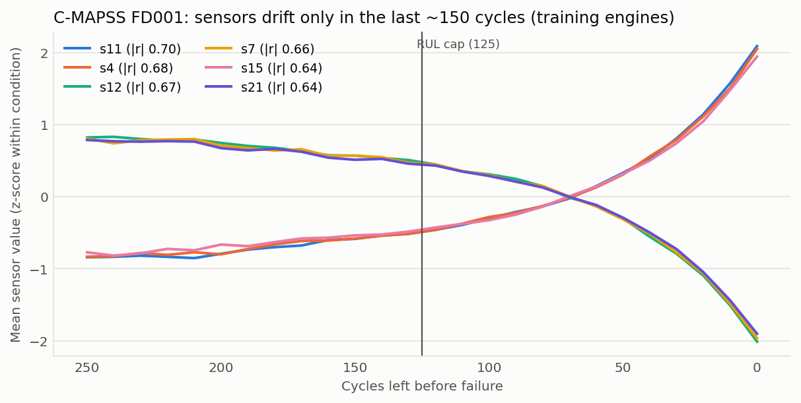

Why the label is capped: in FD001 the most informative sensors are flat until about 150 cycles before failure and then drift steadily. A model cannot tell 250 cycles left from 150, so the training label is capped at 125 and early-life rows all ask for the same answer.

Test RMSE on the last cycle of each engine (the picked model in bold):

| Subset | Engines (train / test) | Constant | Ridge | Random forest | LightGBM | XGBoost | 1D-CNN | GRU | Ensemble | Picked by CV (CV RMSE, test NASA score) |
|---|---|---:|---:|---:|---:|---:|---:|---:|---:|---|
| FD001 (1 condition, 1 fault mode) | 100 / 100 | 43.1 | 22.1 | 19.1 | 18.8 | 18.9 | 16.5 | **15.4** | 16.1 | GRU (13.4, 465) |
| FD002 (6 conditions, 1 mode) | 260 / 259 | 54.1 | 30.9 | 27.9 | 27.6 | 27.6 | 31.8 | 29.7 | **27.4** | ensemble of GRU, LightGBM, XGBoost (15.7, 9,546) |
| FD003 (1 condition, 2 modes) | 100 / 100 | 45.1 | 21.9 | 19.3 | 17.9 | 18.1 | 16.2 | **13.7** | 14.3 | GRU (12.1, 382) |
| FD004 (6 conditions, 2 modes) | 249 / 248 | 54.9 | 33.3 | 29.4 | 28.7 | 28.9 | 33.1 | 30.7 | **28.9** | ensemble of random forest, LightGBM, XGBoost (16.5, 6,027) |

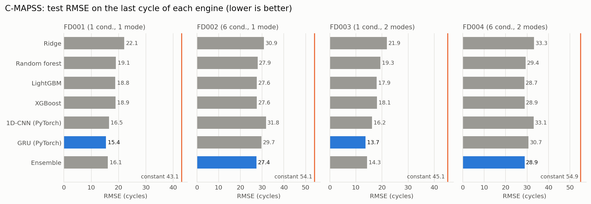

- **The GRU wins on the single-condition subsets, the trees on the six-condition ones.** With six operating regimes the 1D-CNN is the worst model in cross-validation (21.4 and 20.5, behind Ridge's 19.9 and 20.1), and the GRU trails the trees on test. Per-condition standardisation is enough for window statistics, but the raw sequences still carry regime switches that the networks do not absorb with this amount of data.
- **Cross-validation underestimates the test error, most of all with six conditions** (15.7–16.5 against 27.4–28.9 for the picked models). The test engines stop at an arbitrary cycle, while cross-validation scores every row of engines that run to failure, including the many early-life rows that sit at the 125 cap and are easy.
- **The ensemble is never far from the best model**: within 0.8 RMSE of the best test score in every subset, and the best one in FD002.
- **The networks stop learning early.** Their best validation epoch is between 2 and 17 of the 100 they ran, and the validation loss climbs after it (figure below). That is overfitting, not undertraining.
- **These are plain features with fixed hyperparameters**, not a state-of-the-art model, and I do not compare them with published results.

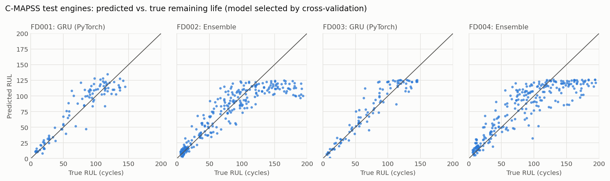

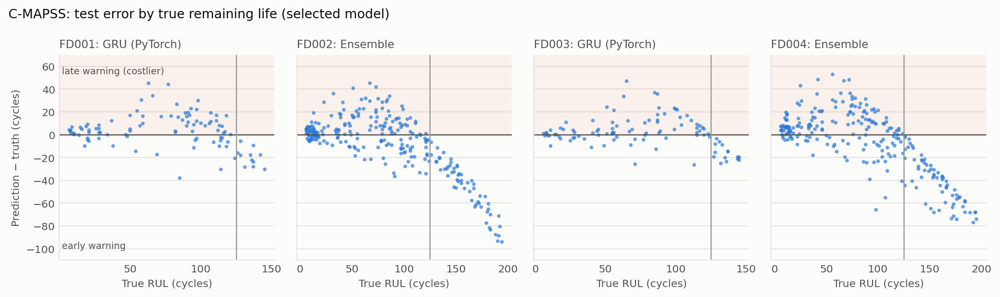

**The six-condition subsets are not as much harder as their RMSE says.** In FD002 and FD004, 22–27% of the test engines have more than 125 cycles left. The capped model under-predicts them by 42–46 cycles on average, an early warning that the NASA score treats as the cheap kind of error. Those engines carry 78% and 70% of the squared error. On engines within their last 125 cycles the RMSE is 14.7 (FD002) and 18.4 (FD004), close to the 14.5 and 12.9 of FD001 and FD003. In that range errors lean late (+2 to +6 cycles on average), the costly direction.

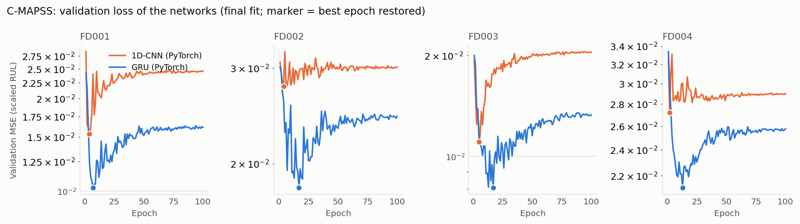

## 4. MetroPT-3: anomaly detection without labels

[MetroPT-3](https://archive.ics.uci.edu/dataset/791) (UCI, CC BY 4.0) is the air production unit of a metro train's compressor. It is the same kind of system as a truck's APS: compressed air for brakes and auxiliaries. It has pressures, oil temperature, motor current and valve signals from February to August 2020, with **no row labels**. The operator's log lists four air leaks, and that log is what the detectors are scored against.

Two things in the file disagree with its description. It has 1,516,948 rows at one reading every ~10 s, not 15 million at 1 Hz. The failure log numbers its rows "#1, #1, #3, #4" and dates one repair before its own failure, which I read as a typo. There are also 230 gaps longer than 10 minutes, 901 hours in total.

Protocol: 10-minute windows (21 features: means, spreads, minimum pressures, share of time each valve is active, compressor starts). Detectors are fitted on 1 February – 15 March, and the alarm threshold is the 99.5th percentile of the 30-minute-smoothed score on 16–31 March. Scoring runs from 1 April to 31 August. A leak counts as detected if there is an alarm between 2 h before its reported start and its end. A false alarm is an alarm episode that starts outside every failure zone. The chance level is the same alarm series shifted in time 500 times: it keeps how much the detector alarms but not when.

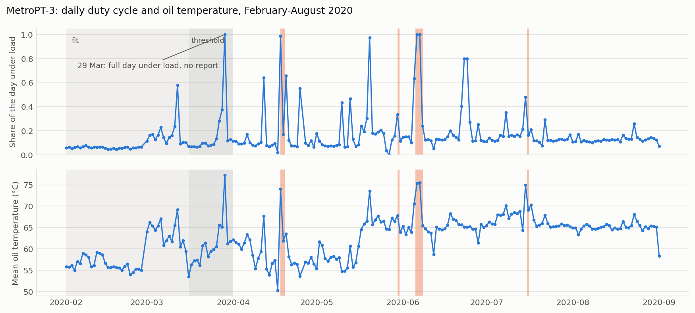

Before any model: the share of the day the compressor runs under load sits near 6% in February and roughly doubles from mid-May, and the oil temperature rises about 10 °C with the summer. A detector fitted in winter has to tell that seasonal drift from a leak. The "healthy" reference also holds 29 March, a full day under load with no failure in the log.

| Detector (feature view) | Leaks detected (of 4) | Expected by chance | False alarms / week | Normal time in alarm |
|---|---:|---:|---:|---:|
| Low-pressure switch already on the unit (rule) | 2 | 0.51 | 1.6 | 0.4% |
| Duty-cycle z-score | 0 | 0.00 | 0.0 | 0.0% |
| PCA reconstruction error | 4 | 2.08 | 7.0 | 19.7% |
| Isolation forest | 2 | 0.36 | 0.8 | 0.7% |
| Autoencoder (PyTorch, seed 42) | 4 | 2.00 | 7.9 | 8.9% |
| PCA, drift-adjusted features | 4 | 2.66 | 12.0 | 27.7% |
| Isolation forest, drift-adjusted | 2 | 0.46 | 1.1 | 0.7% |
| Autoencoder, drift-adjusted | 4 | 2.21 | 6.7 | 20.5% |

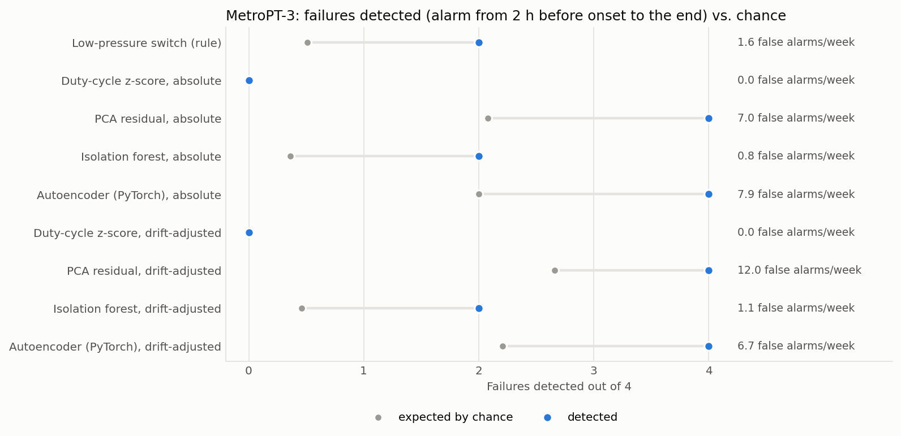

**The autoencoder depends on its initialisation.** The same protocol with six seeds:

| Seed | 42 | 1 | 2 | 3 | 4 | 5 |
|---|---:|---:|---:|---:|---:|---:|
| Leaks detected | 4 | 4 | 4 | 4 | 4 | 4 |
| Expected by chance | 2.00 | 2.03 | 1.83 | 2.04 | 1.72 | 1.69 |
| False alarms / week | 7.9 | 13.7 | 7.9 | 10.6 | 5.9 | 5.5 |

It catches all four leaks in every run, but its false alarms range from 5.5 to 13.7 a week. A single run would have made it look better or worse than it is. (An earlier version of this pipeline built the network before fixing the seed, so its weights depended on whatever had run before in the process. That is how a 3.8 got into a previous README.)

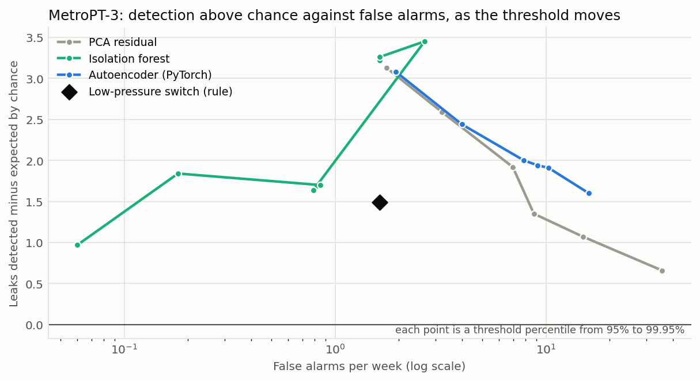

**One threshold hides the trade-off.** Moving the threshold percentile from 95% to 99.95% traces each detector's operating curve. The isolation forest dominates. At the 98th percentile it would detect all four leaks with 1.6 false alarms a week and 0.7 expected by chance, while the fixed 99.5th percentile left it at 2 of 4. I report the fixed percentile in the table because choosing it from this curve would mean tuning on the evaluation period. A deployment should fix it on a later validation window.

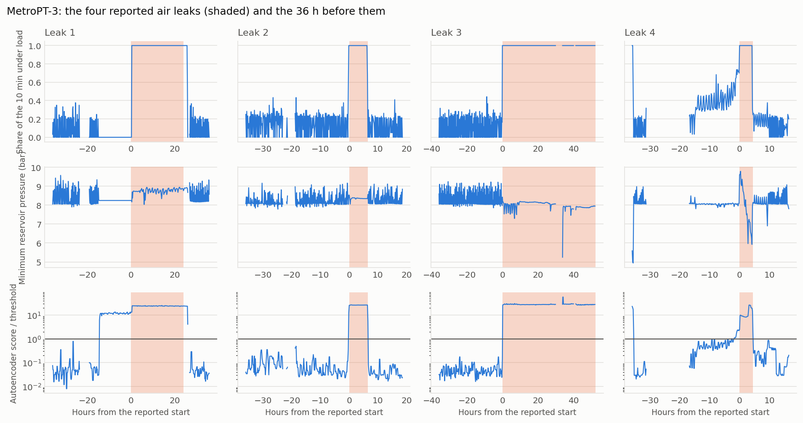

**What the leaks look like.** Leaks 2 and 3 start abruptly. The compressor jumps from about 15% to 100% load with no change in the hours before, so no detector can warn ahead of them. Leak 4 has a 15-hour precursor: the load share more than doubles (0.18 to 0.42 on average) and the autoencoder crosses its threshold 1.8 h before the reported start. Leak 1 is preceded by about 15 hours with the compressor off. The autoencoder flags that 14.5 h ahead, but it is an unusual state, not a recognisable leak signature.

- **The low-pressure switch the unit already has catches 2 of 4, late.** It fires 34 h and 3 h after the reported start of leaks 3 and 4. That is the baseline any model has to beat.
- **Subtracting a trailing 7-day median (drift adjustment) did not help.** I expected it to absorb the summer rise in duty cycle and oil temperature. It made PCA and the autoencoder spend 20–28% of normal time in alarm, and I report it as it came out.
- **The duty-cycle z-score is blind** because its reference period contains 29 March, a day at 100% load (see finding 4 above). I kept the protocol as fixed instead of moving the reference after seeing the evaluation period.

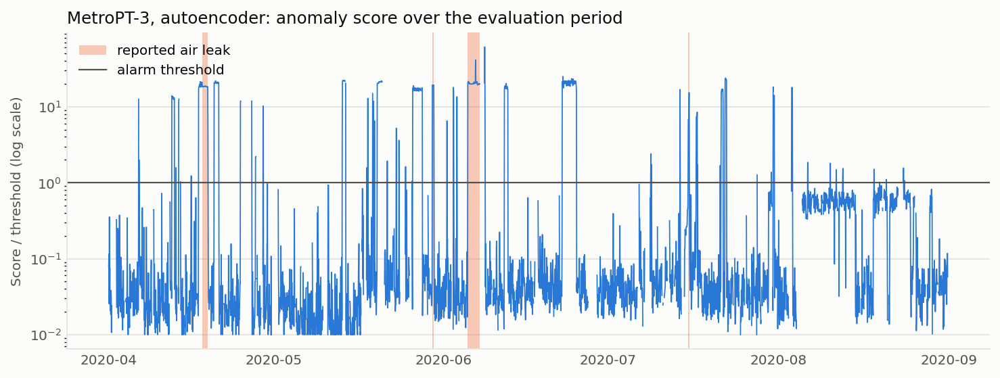

---

## Limitations

- **None of this is mining data.** Road trucks, a metro compressor and simulated turbofans share the structure of mining fleet maintenance (usage counters, rare and costly failures, censoring), but I have no evidence that the numbers transfer to a mine.
- **The SCANIA scale factors are an inference.** I derive them from the data. They are consistent across the bins of each variable, but the dataset does not document them per split.
- **Few failures.** 136 and 142 failing SCANIA trucks, 375 APS failures, 4 MetroPT leaks. The intervals are wide, and on MetroPT-3 four events cannot rank detectors with confidence.
- **The cost matrices are the challenges'.** The savings are only as good as those figures. The SCANIA sensitivity analysis and the interactive page exist for that.
- **Anonymised variables** (SCANIA, APS), so no physical diagnosis.
- **Fixed hyperparameters.** I tuned nothing, so every model could probably do somewhat better. The comparison is between families under the same budget, not between their best possible versions.
- **Networks are deterministic on the same hardware** (fixed seeds, deterministic cuBLAS and cuDNN), but CPU and GPU give slightly different numbers. The seed analyses show that the choice of seed moves results more than that.

## Reproduce

```bash
python -m venv .venv && source .venv/bin/activate   # Windows: .venv\Scripts\activate
pip install -r requirements.txt                     # for CPU-only PyTorch: pip install torch --index-url https://download.pytorch.org/whl/cpu

python -m src.cli download    # ~2.1 GB into data/raw (hash-verified)
python -m src.cli all         # scania, aps, cmapss, metropt, figures, site
pytest                        # tests on synthetic data; the ones that need a dataset skip if it is missing
```

Run times on a 16-core CPU with an RTX 4060 Ti: SCANIA ~45 min (CatBoost ~10, the seed analysis ~12), APS ~12 min, C-MAPSS ~1.5 h (deterministic cuDNN is slower), MetroPT-3 ~10 min (six autoencoder seeds). Each step can run alone: `python -m src.cli scania`, and so on.

Outputs: `reports/<dataset>/results.json`, figures in `reports/figures/{en,es}/`, the page in `docs/`. Models and checkpoints go to `data/processed/models/`, which is not versioned.

## API

`POST /score` takes the readout history of one SCANIA truck and its `Spec_0…Spec_7`, and returns class probabilities, the expected cost of each action and the recommended one. It needs an `X-API-Key` header and is rate limited per IP. `GET /health` is open.

```bash
export RISK_API_KEY=change-me
uvicorn src.api.main:app
```

The model is the selected SCANIA classifier on scale-invariant features. Its probabilities are recalibrated with a single Platt fit on validation and test together, to serve them and not to report performance. `probabilidad_algun_riesgo_cruda` gives the raw value.

## Layout

```
src/cli.py                      single entry point (download, scania, aps, cmapss, metropt, figures, site, all)
src/data/                       one loader per dataset: download with SHA-256 checks, parsing, labels
src/features/engineering.py     SCANIA per-readout features, including the scale-invariant subset
src/models/zoo.py               common interface for LR, RF, LightGBM, XGBoost, CatBoost and the MLP
src/models/nets.py              PyTorch training loop: min. 100 epochs, early stopping, checkpoints
src/models/evaluation.py        cost-minimising threshold, bootstrap intervals
src/models/train_pipeline.py    SCANIA: scale diagnosis, classifiers, time to failure, survival, SHAP
src/models/aps_pipeline.py      APS: cross-validated model zoo under the challenge cost
src/models/rul_estimator.py     C-MAPSS models (tabular and sequence)
src/models/rul_benchmark.py     C-MAPSS FD001-FD004 benchmark
src/models/metropt_pipeline.py  MetroPT-3 windows, detectors, event scoring, chance level
src/models/scania_analysis.py   SCANIA survival, lead time, curves, cost breakdown, paired bootstrap
src/models/make_figures.py      results figures, in English and Spanish
src/models/analysis_figures.py  analysis figures (exploration, diagnostics, robustness), in English and Spanish
src/models/cost_decision.py     minimum-expected-cost decision under the SCANIA matrix
src/models/calibration.py       calibration tables, Platt scaling, sensitivity to the visit cost
src/site.py                     builds the GitHub Pages page (docs/, generated)
src/api/main.py                 FastAPI service
tests/                          unit tests on synthetic data, plus consistency checks on the reported results
```

An earlier version of this repository ran on a synthetic data generator and contained a multi-task PyTorch network and a Streamlit dashboard. I removed them when it moved to real data; they remain in the git history.

## License and data

Code: MIT. Data, not redistributed here (each loader downloads it from the source):

- SCANIA Component X: © Scania CV AB, CC BY 4.0. Lindgren et al., *SCANIA Component X dataset: a real-world multivariate time series dataset for predictive maintenance*, [arXiv:2401.15199](https://arxiv.org/abs/2401.15199).
- APS Failure at Scania Trucks: © Scania CV AB, GNU GPL v3, UCI Machine Learning Repository.
- NASA C-MAPSS: Saxena et al., *Damage propagation modeling for aircraft engine run-to-failure simulation*, PHM 2008. NASA Prognostics Center of Excellence.
- MetroPT-3: Veloso et al., *The MetroPT dataset for predictive maintenance*, Scientific Data 9, 764 (2022). CC BY 4.0, UCI Machine Learning Repository.
