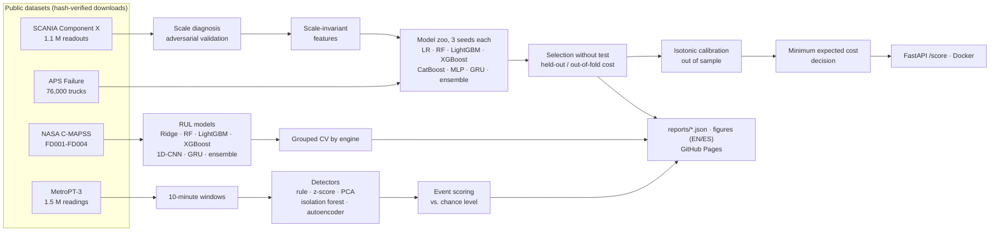

# Predictive maintenance on real heavy-vehicle data

[English ] | [[Español](README.es.md) ]


**Which trucks should go to the workshop, and how much does that save?** Four public predictive-maintenance datasets (two real Scania truck fleets, a metro train's air compressor and NASA's turbofan benchmark), eight model families, and one rule throughout: nothing is selected by looking at the test set, and every headline number carries an interval or a chance level.

**[Interactive page](https://rxyxs.github.io/heavy-truck-predictive-maintenance/)** · **[5-minute quickstart notebook](notebooks/quickstart.ipynb)** · **[Run the API in Docker](#try-it-in-two-minutes)** · **[Model release](https://github.com/Rxyxs/heavy-truck-predictive-maintenance/releases)**


## At a glance

| Dataset | Task | Data | Model picked without the test set | Result on the test set |
|---|---|---|---|---|
| [SCANIA Component X](#1-scania-component-x-risk-decision-under-a-cost-matrix) | 5-class failure window → maintenance action | real, 33,641 trucks | mean of LightGBM, XGBoost and CatBoost, each averaged over 3 seeds | **29.1%** lower official cost (95% CI 18.6–37.6); 41.7% on validation |
| [APS Failure at Scania Trucks](#2-aps-failure-at-scania-trucks-cost-weighted-classification) | air-pressure-system failure, yes/no | real, 76,000 trucks | mean of LightGBM, XGBoost and CatBoost | cost **9,150** (95% CI 6,620–11,850); challenge winner: 9,920 |
| [NASA C-MAPSS](#3-nasa-c-mapss-remaining-useful-life) | remaining useful life | simulated, 1,416 engines | picked per subset by grouped CV (GRU or ensemble) | RMSE **15.4 / 27.4 / 13.7 / 28.9** on FD001–FD004; a constant scores 43–55 |
| [MetroPT-3](#4-metropt-3-anomaly-detection-without-labels) | air-leak detection, no labels | real, 1.5 M readings | five detectors reported side by side | autoencoder: **4 of 4** leaks in all 6 seeds (~2 expected by chance), 5.5–13.7 false alarms/week |

## Key findings

1. **The SCANIA Component X splits are on different scales.** Each anonymised variable is multiplied by its own factor (×0.16 to ×3.9) that changes between training, validation and test; a classifier tells the splits apart with AUC 1.00. With features that cancel the factor, the same LightGBM predicts 4.2% mean risk instead of 16.9% (2.7% observed), and its saving survives workshop visits up to ×4.14 (validation) and ×3.12 (test) the benchmark's cost, instead of ×1.65 and ×1.90. [Details](#the-hidden-scale-shift)
2. **One seed per model picks the luckiest initialisation.** Retrained with three seeds, every family's held-out score moves by up to 185 per 1,000 trucks, more than the gap between the best models. Averaging each family over its seeds makes the selection stable and improves the models themselves: LightGBM's held-out cost goes from 5,382–5,419 per seed to 5,208 averaged. [Details](#how-much-of-the-ranking-is-noise)
3. **On APS the threshold transfers.** It is fixed on out-of-fold training predictions; re-tuning it on the test set (not a valid result) would lower the cost by only 60. [Details](#2-aps-failure-at-scania-trucks-cost-weighted-classification)
4. **MetroPT-3's "healthy" reference is not healthy, and its autoencoder depends on the seed.** On 29 March the compressor ran under load all day with no failure in the log, which blinds a duty-cycle detector. The autoencoder catches all four leaks with every seed, but its false alarms range from 5.5 to 13.7 a week. [Details](#4-metropt-3-anomaly-detection-without-labels)
5. **Sequence models win on simple sequences, not on noisy fleets.** A GRU is the best model on the single-condition C-MAPSS subsets (RMSE 15.4 and 13.7), but on the SCANIA readout histories it saves 21.1% on test against 29.1% for the boosting ensemble, and the MLP trails boosting on both tabular problems.

## Try it in two minutes

The trained SCANIA model is published as a release asset, so the API runs without downloading any data or training anything:

```bash
docker build -t truck-risk .
docker run -p 8000:8000 -e RISK_API_KEY=change-me truck-risk
curl -s -X POST localhost:8000/score -H "X-API-Key: change-me" -H "Content-Type: application/json" \
     --data @examples/truck_189_class4.json
```

Or without Docker: `pip install -r requirements.txt`, then `python -m src.demo fetch-model` and `python -m src.demo score`. The four example trucks are real validation trucks, chosen to show both sides of the model:

| Example | What really happened | Readouts | Predicted risk | Recommendation |
|---|---|---:|---:|---|
| `truck_10_class0.json` | no repair within 48 units | 102 | 1.3% | no action (class 0) |
| `truck_1285_class3.json` | repaired 6–12 units later | 109 | 6.1% | take off the road now (class 4) |
| `truck_189_class4.json` | repaired within 6 units | 61 | 4.1% | urgent check (class 3) |
| `truck_3309_class4.json` | repaired within 6 units | 32 | 1.1% | no action (class 0) |

The model misses about four in ten failing trucks at the benchmark's costs, and truck 3309 is one of them.

## Architecture



## Shared protocol

- **No selection on the test set.** SCANIA picks on held-out training trucks, APS on out-of-fold training predictions, C-MAPSS on cross-validation grouped by engine. MetroPT-3 has no labels to select with, so all five detectors are reported. The test set is looked at once, with every model.
- **Early stopping on a separate set.** Boosting models and networks stop on data that is neither the scored fold nor the test set.
- **Neural networks** (PyTorch): at least 100 epochs, early stopping by patience after that, best checkpoint restored and saved (`src/models/nets.py`). They run on the GPU when one is available.
- **Seeds.** Every SCANIA family is trained with three seeds and selected on their averaged probabilities; the MetroPT autoencoder is reported over six seeds.
- **Uncertainty.** Bootstrap intervals by truck for costs and savings, and paired bootstrap between models. For MetroPT-3, a chance level: the same alarm series shifted in time 500 times.
- **Hyperparameters are fixed up front** and are the same across datasets unless stated. Nothing is tuned on validation or test.

---

## 1. SCANIA Component X: risk decision under a cost matrix

[SCANIA Component X](https://researchdata.se/en/catalogue/dataset/2024-34) (CC BY 4.0) is the dataset of the IDA 2024 Industrial Challenge: 23,550 training trucks (2,272 repairs of an anonymised engine component), and 5,046 validation and 5,045 test trucks with **one randomly chosen readout each**, to mimic standing at "today". The label is the time left before the repair: 0 = more than 48 time units, 1–4 = 24–48, 12–24, 6–12 or 0–6. The challenge scores each recommendation with an asymmetric matrix. An unnecessary check costs 7–10 and a missed failure 200–500, so the reference to beat is "recommend nothing": 57,400 on validation and 56,100 on test.

<details>
<summary>Cost matrix</summary>

| | recommend 0 | 1 | 2 | 3 | 4 |
|---|---|---|---|---|---|
| **healthy (0)** | 0 | 7 | 8 | 9 | 10 |
| **fails in 24–48 (1)** | 200 | 0 | 7 | 8 | 9 |
| **fails in 12–24 (2)** | 300 | 200 | 0 | 7 | 8 |
| **fails in 6–12 (3)** | 400 | 300 | 200 | 0 | 7 |
| **fails in 0–6 (4)** | 500 | 400 | 300 | 200 | 0 |

</details>

**Features.** All 105 operational columns are cumulative counters and histogram bins, so the features are usage rates, histogram fractions and their recent change, computed from each truck's past only. A test recomputes every feature on truncated histories to check that nothing looks ahead. The decision is the action with the **lowest expected cost** under the model's class probabilities, not the most probable class.

### The hidden scale shift


Comparing the median usage rate of each variable across splits shows a factor per variable that is consistent across its histogram bins and different in each split. Variable 272 is at ×0.16 of its training scale in validation and ×0.87 in test, and variable 397 at ×3.9 and ×1.8. The paper that describes the dataset says some perturbations "like scaling" were applied; it does not say they differ between splits.

| Adversarial validation (LightGBM, 5-fold AUC) | train vs. validation | train vs. test | validation vs. test |
|---|---:|---:|---:|
| All 512 readout features | 1.00 | 1.00 | 1.00 |
| Scale-invariant readout features only (302) | 0.82 | 0.81 | 0.67 |

Rates inherit the factor. Histogram fractions and the ratio of the recent to the lifetime rate (`rel_rate_*`) cancel it. What still separates the splits once the scale is gone is mostly `time_step`:


The dataset describes the validation and test readout as "selected randomly among all readouts" of each truck. It is not uniform. A random training readout falls before time 60 for 26.5% of trucks, but the validation and test readouts do so for 0.9%, and their median sits at 169–172 time units against 109. The model trains on early-life readouts it is never evaluated on. The selection weights (1 / readouts per truck) assume the documented protocol, so they do not correct for this either.

### Eight classifiers, picked on held-out training trucks

Training uses every risky readout plus 5% of the healthy ones (re-weighted ×20), split by truck into 70% fit, 15% early stopping and 15% selection. The selection score is the expected official cost on the selection trucks, with each readout weighted by 1 / (readouts of its truck), the one-random-readout protocol of validation and test. **Each family is trained with three seeds and its probabilities are averaged** (the logistic regression has no randomness and runs once). The GRU reads each truck's last 8 readouts of the 48 invariant features with the most gain in LightGBM.

| Model (probabilities averaged over its seeds) | Held-out cost / 1,000 trucks | Validation saving (95% CI) | Test saving (95% CI) | Mean predicted risk (val. / test) | Saving runs out at (val. / test) |
|---|---:|---:|---:|---:|---:|
| Logistic regression (1 seed, deterministic) | 5,254 | 31.8% (22.2–40.8) | 21.6% (11.3–30.5) | 3.5% / 3.4% | ×4.14 / ×2.35 |
| Random forest | 7,758 | 21.4% (5.7–32.6) | 18.8% (4.1–30.5) | 17.3% / 17.1% | ×1.29 / ×1.20 |
| LightGBM | 5,208 | 37.6% (28.3–46.1) | 30.1% (19.2–38.6) | 4.2% / 4.2% | ×4.14 / ×3.12 |
| XGBoost | 5,089 | 41.8% (32.7–50.1) | 32.7% (22.0–41.5) | 3.6% / 3.6% | ×10.73 / ×4.60 |
| CatBoost | 5,348 | 40.2% (30.3–48.3) | 26.2% (15.7–35.1) | 3.1% / 3.1% | ×7.81 / ×3.59 |
| MLP (PyTorch) | 5,127 | 36.9% (26.4–46.1) | 25.8% (15.5–35.5) | 3.7% / 3.7% | ×10.00 / ×2.61 |
| GRU on the last 8 readouts (PyTorch) | 5,432 | 34.8% (24.4–44.0) | 21.1% (10.7–30.6) | 3.1% / 3.1% | ×3.59 / ×2.90 |
| **Ensemble of the 3 boosting families (selected)** | **5,019** | **41.7% (32.4–50.3)** | **29.1% (18.6–37.6)** | **3.7% / 3.6%** | **×6.32 / ×3.99** |
| *LightGBM on raw-scale features (previous version, 1 seed) | 5,105 | 28.7% (16.6–37.9) | 28.5% (18.0–37.3) | 16.9% / 7.7% | ×1.65 / ×1.90* |

Observed failure rate: 2.7% on validation and 2.8% on test. "Saving runs out at" is the cost of an unnecessary visit, as a multiple of the benchmark's 7–10, above which the saving falls below 1%.


- **The boosting ensemble is selected on held-out trucks (5,019 per 1,000), and XGBoost alone is the best model on test.** The paired bootstrap below puts XGBoost ahead of the selected ensemble in 99.6% of test resamples (+3.7 points, 95% interval +0.7 to +7.1), but they tie on validation (+0.1 points, 52%). With 136 and 142 failing trucks, the good models' intervals overlap.
- **Reading the trajectory does not help.** The GRU over the last 8 readouts saves 21.1% on test, below every boosting model: the recent-rate features already summarise what the history adds, and the network overfits within 4–5 epochs.
- **The random forest is badly calibrated** (17% predicted risk). Its leaves average the re-weighted training rows, so a leaf made only of risky rows predicts 100%. It ranks reasonably (test AUC 0.64); its probabilities are the problem.
- **The raw-scale model's test saving looks fine** (28.5%), which is how the scale problem hid in the previous version of this repository. Its probabilities are not credible, and the robustness section shows what that costs.

### How much of the ranking is noise


| Family | Held-out cost, seeds 42 / 1 / 2 | Averaged over seeds | Test saving, seeds 42 / 1 / 2 | Averaged |
|---|---:|---:|---:|---:|
| LightGBM | 5,385 / 5,382 / 5,419 | **5,208** | 26.2% / 27.5% / 27.3% | 30.1% |
| XGBoost | 5,131 / 5,263 / 5,173 | **5,089** | 30.6% / 31.7% / 32.8% | 32.7% |
| CatBoost | 5,296 / 5,322 / 5,481 | **5,348** | 28.1% / 24.4% / 24.7% | 26.2% |
| MLP | 5,116 / 5,271 / 5,237 | **5,127** | 24.2% / 21.5% / 26.7% | 25.8% |
| GRU | 5,512 / 5,406 / 5,497 | **5,432** | 22.1% / 21.4% / 20.4% | 21.1% |
| Random forest | 7,756 / 7,762 / 7,726 | **7,758** | 18.2% / 19.1% / 17.4% | 18.8% |

The first version of this pipeline trained each family once, with seed 42. That picked the MLP, because seed 42 was its best draw (5,116, against 5,237–5,271 with the other seeds), and on test the MLP saved less than any boosting model. Averaging seeds removes that luck from the selection, and the averaged models are better than their typical seed: LightGBM goes from 5,382–5,419 per seed to 5,208. This is protocol v2. I adopted it after the seed analysis, which uses held-out trucks and not test, and I report every family under it.


The paired bootstrap resamples the same trucks for every model, which removes the noise they share. On test, XGBoost beats the selected ensemble in 99.6% of resamples and LightGBM in 67%; CatBoost, the MLP and the raw-scale model do not (12–42%). On validation only XGBoost ties it (52%).

### Robustness to the cost assumption


With credible probabilities the minimum-expected-cost policy should never do worse than doing nothing; it should just alarm less as visits get more expensive. Same model and hyperparameters, only the features change: on raw-scale features LightGBM loses money as soon as a visit costs about twice the benchmark's and reaches −138% (validation) and −45% (test) at ×10. On invariant features it stays above zero up to ×3 and ends at −10% and −14%. At ×1 the invariant model now also saves more on test (30.1% against 28.5%), but the main gain is robustness to the cost assumption.

**Calibrating out of sample helps a little more.** An isotonic regression fitted on the selection trucks (held out from training, never validation or test) raises the selected ensemble's saving from 41.7% to 44.1% on validation and from 29.1% to 30.9% on test, and keeps it near zero at ×10 instead of negative. The API serves these calibrated probabilities.

### Where the cost comes from, and how early a failure shows


Doing nothing costs 56,100 on test, all of it missed failures. The selected ensemble removes more than half of that and adds 14,430 of false alarms; missed failures are still the largest share of what is left (23,800 of 39,773). The raw-scale model gets a similar total the other way round, alarming more (21,207) and missing less (14,200), as a model that overstates risk does. The random forest alarms almost everyone (43,940 in false alarms).


On every readout of held-out training trucks, the share that gets an alarm rises steadily as the repair approaches. For the selected ensemble it is 6% more than 192 units out, 24% at 96–192, 44% at 48–96 and 73% in the last 6 units, against 20% for trucks that are never repaired. The signal is a slow drift that starts 100–200 time units before the repair, much earlier than the 48-unit window the challenge scores, which is why the model cannot tell the windows apart and almost always recommends class 4.


Ranking power is modest and similar across the boosting models: any-risk ROC AUC 0.70–0.71 on test for XGBoost, LightGBM, the ensemble and the raw-scale model, 0.66 for the MLP and 0.65 for the GRU. Average precision is 0.05–0.08 against a base rate of 0.028.


Over the study, 9.6% of training trucks had component X repaired. Of the eight anonymised specifications, `Spec_7` separates survival most (log-rank χ² 425, p < 10⁻⁸⁰). Its category Cat1 has a 14.1% repair rate against 7.0% for Cat4, while `Spec_5` does not separate it at all (p = 0.36). `Spec_7` is also the second most important feature of the time-to-failure model below.

<details>
<summary>What the decision looks like, time to failure, survival models and SHAP</summary>

**Decision (selected ensemble, minimum expected cost).** It alarms 96 of 136 failing trucks on validation (71%) and 82 of 142 on test (58%), and 31% and 30% of healthy trucks. About 87% of its alarms are class 4, so in practice it is an "alarm / no alarm" switch and does not resolve the intermediate windows. Any-risk ROC AUC: 0.745 on validation and 0.705 on test.


**Time to failure** (LightGBM on `log1p`, trucks that failed, 568 held-out trucks): MAE 45.5 against 67.1 for the median, and 39.5 against 80.4 within 48 units of the repair. It beats the baseline but cannot locate the failure inside a 48-unit window, and it is conditional on the truck failing.

**Survival from a landmark at 50 time units** (23,333 trucks at risk; early usage + specifications; held-out C-index):

| Model | C-index |
|---|---:|
| Cox proportional hazards | 0.697 |
| Weibull AFT | 0.690 |
| Random survival forest | **0.719** |
| Cox, specifications only | 0.651 |
| Cox, early usage only | 0.665 |


The time-to-failure model leans on how long the truck has been running (`time_step`, `n_readouts`) and on its configuration (`Spec_7`). The operating variables are anonymised, so there is no physical diagnosis.

</details>

<details>
<summary>Calibration: mean predicted risk over observed, every model</summary>


</details>

## 2. APS Failure at Scania Trucks: cost-weighted classification

[APS Failure at Scania Trucks](https://archive.ics.uci.edu/dataset/421) (UCI, GPL-3.0, © Scania CV AB) is the dataset of the IDA 2016 challenge. Each truck is one row of 170 anonymised counters and histograms, and the positive class is a failure of a component of the air pressure system (brakes, gear changes). Training has 60,000 trucks (1,000 failures, 1.7%) and test 16,000 (375, 2.3%), with 8.3% missing values. Cost = 10 × unnecessary checks + 500 × missed failures. The file that ships with the data lists the podium: **9,920 / 10,900 / 11,480**.

Protocol: 5-fold stratified cross-validation on training (class-balanced weights; boosting and the MLP stop early on 15% of each training fold). The alarm threshold is the one that minimises the cost on the out-of-fold predictions. The test prediction is the mean of the five fold models. The pick is the lowest out-of-fold cost.

| Model | Out-of-fold cost (60,000 trucks) | Test cost (95% CI) | False alarms | Missed | Test PR-AUC |
|---|---:|---:|---:|---:|---:|
| Logistic regression | 51,570 | 11,310 (8,439–14,720) | 631 | 10 | 0.844 |
| Random forest | 42,120 | 9,400 (6,840–12,070) | 590 | 7 | 0.899 |
| LightGBM | 43,050 | 10,290 (7,040–13,680) | 479 | 11 | 0.881 |
| XGBoost | 44,140 | 10,340 (7,250–13,630) | 534 | 10 | 0.871 |
| CatBoost | 42,970 | 9,670 (7,370–12,270) | 667 | 6 | 0.876 |
| MLP (PyTorch) | 54,140 | 12,610 (9,690–16,080) | 761 | 10 | 0.841 |
| **Ensemble (selected)** | **42,080** | **9,150 (6,620–11,850)** | **565** | **7** | 0.879 |

Doing nothing costs 187,500 and alarming every truck 156,250.


The selected ensemble's point estimate is below the challenge winner's, but the winner's 9,920 sits inside its interval, so I read it as on par, not better. The contestants did not have the test labels either. The MLP reaches its best early-stopping loss between epochs 3 and 8 of the 100 it ran in each fold, and is the weakest model. Many published results on this dataset tune the threshold on the test set, which is not a valid result. Doing that here would lower the ensemble's cost by only 60.


**The cost is flat around the chosen threshold.** Out-of-fold, it stays within 10% of its minimum for every threshold between 0.12 and 0.33, and the threshold fixed there (0.25) also sits at the bottom of the test curve. That is why re-tuning on test buys almost nothing.


At this cost ratio only the high-recall end matters. The selected ensemble catches 368 of 375 failures (98.1%) at a precision of 39%. Most models are close there, and the MLP falls behind over the whole curve.


**Missing values carry signal.** Trucks with a complete record fail 12.9% of the time (591 trucks), and the 43,874 with 6–20 missing values fail 0.7%. The variables are anonymised, so I cannot tell why. The boosting models use missingness natively; the linear model and the MLP see it through indicator columns and the `n_missing` feature.


All seven histogram variables are among the ten most important (mean |SHAP| of a LightGBM reference model, summed over each variable's columns). The sum favours variables with more columns: a histogram has 10 bins plus their shares. Among single features, the counters `ck_000`, `ci_000` and `bj_000` lead.

## 3. NASA C-MAPSS: remaining useful life

[C-MAPSS](https://www.nasa.gov/intelligent-systems-division/discovery-and-systems-health/pcoe/pcoe-data-set-repository/) is a **simulation** of aircraft turbofan engines run to failure, not truck data. I include it because it is the standard public yardstick for remaining useful life (RUL), with an official asymmetric score. FD001–FD004 combine one or six operating conditions with one or two fault modes.

Protocol: the training label is cycles to failure capped at 125. The test set is scored on the last observed cycle of each engine against the true RUL, uncapped. Sensors are standardised within operating condition (k-means on the three settings). The tabular models see the current value, the 10-cycle mean, standard deviation and change of each sensor. The 1D-CNN and the GRU see the raw sequence of the last 30 cycles. Selection is 5-fold cross-validation grouped by engine; the ensemble is the mean of the three models with the lowest CV error. NASA score: `exp(-d/13) - 1` if early, `exp(d/10) - 1` if late, `d` = prediction − truth (lower is better).


Why the label is capped: in FD001 the most informative sensors are flat until about 150 cycles before failure and then drift steadily. A model cannot tell 250 cycles left from 150, so the training label is capped at 125 and early-life rows all ask for the same answer.

Test RMSE on the last cycle of each engine (the picked model in bold):

| Subset | Engines (train / test) | Constant | Ridge | Random forest | LightGBM | XGBoost | 1D-CNN | GRU | Ensemble | Picked by CV (CV RMSE, test NASA score) |
|---|---|---:|---:|---:|---:|---:|---:|---:|---:|---|
| FD001 (1 condition, 1 fault mode) | 100 / 100 | 43.1 | 22.1 | 19.1 | 18.8 | 18.9 | 16.5 | **15.4** | 16.1 | GRU (13.4, 465) |
| FD002 (6 conditions, 1 mode) | 260 / 259 | 54.1 | 30.9 | 27.9 | 27.6 | 27.6 | 31.8 | 29.7 | **27.4** | ensemble of GRU, LightGBM, XGBoost (15.7, 9,546) |
| FD003 (1 condition, 2 modes) | 100 / 100 | 45.1 | 21.9 | 19.3 | 17.9 | 18.1 | 16.2 | **13.7** | 14.3 | GRU (12.1, 382) |
| FD004 (6 conditions, 2 modes) | 249 / 248 | 54.9 | 33.3 | 29.4 | 28.7 | 28.9 | 33.1 | 30.7 | **28.9** | ensemble of random forest, LightGBM, XGBoost (16.5, 6,027) |


- **The GRU wins on the single-condition subsets, the trees on the six-condition ones.** With six operating regimes the 1D-CNN is the worst model in cross-validation (21.4 and 20.5, behind Ridge's 19.9 and 20.1), and the GRU trails the trees on test. Per-condition standardisation is enough for window statistics, but the raw sequences still carry regime switches that the networks do not absorb with this amount of data.
- **Cross-validation underestimates the test error, most of all with six conditions** (15.7–16.5 against 27.4–28.9 for the picked models). The test engines stop at an arbitrary cycle, while cross-validation scores every row of engines that run to failure, including the many early-life rows that sit at the 125 cap and are easy.
- **The ensemble is never far from the best model**: within 0.8 RMSE of the best test score in every subset, and the best one in FD002.
- **The networks stop learning early.** Their best validation epoch is between 2 and 17 of the 100 they ran, and the validation loss climbs after it (figure below). That is overfitting, not undertraining.
- **These are plain features with fixed hyperparameters**, not a state-of-the-art model, and I do not compare them with published results.


**The six-condition subsets are not as much harder as their RMSE says.** In FD002 and FD004, 22–27% of the test engines have more than 125 cycles left. The capped model under-predicts them by 42–46 cycles on average, an early warning that the NASA score treats as the cheap kind of error. Those engines carry 78% and 70% of the squared error. On engines within their last 125 cycles the RMSE is 14.7 (FD002) and 18.4 (FD004), close to the 14.5 and 12.9 of FD001 and FD003. In that range errors lean late (+2 to +6 cycles on average), the costly direction.


## 4. MetroPT-3: anomaly detection without labels

[MetroPT-3](https://archive.ics.uci.edu/dataset/791) (UCI, CC BY 4.0) is the air production unit of a metro train's compressor. It is the same kind of system as a truck's APS: compressed air for brakes and auxiliaries. It has pressures, oil temperature, motor current and valve signals from February to August 2020, with **no row labels**. The operator's log lists four air leaks, and that log is what the detectors are scored against.

Two things in the file disagree with its description. It has 1,516,948 rows at one reading every ~10 s, not 15 million at 1 Hz. The failure log numbers its rows "#1, #1, #3, #4" and dates one repair before its own failure, which I read as a typo. There are also 230 gaps longer than 10 minutes, 901 hours in total.

Protocol: 10-minute windows (21 features: means, spreads, minimum pressures, share of time each valve is active, compressor starts). Detectors are fitted on 1 February – 15 March, and the alarm threshold is the 99.5th percentile of the 30-minute-smoothed score on 16–31 March. Scoring runs from 1 April to 31 August. A leak counts as detected if there is an alarm between 2 h before its reported start and its end. A false alarm is an alarm episode that starts outside every failure zone. The chance level is the same alarm series shifted in time 500 times: it keeps how much the detector alarms but not when.


Before any model: the share of the day the compressor runs under load sits near 6% in February and roughly doubles from mid-May, and the oil temperature rises about 10 °C with the summer. A detector fitted in winter has to tell that seasonal drift from a leak. The "healthy" reference also holds 29 March, a full day under load with no failure in the log.

| Detector (feature view) | Leaks detected (of 4) | Expected by chance | False alarms / week | Normal time in alarm |
|---|---:|---:|---:|---:|
| Low-pressure switch already on the unit (rule) | 2 | 0.51 | 1.6 | 0.4% |
| Duty-cycle z-score | 0 | 0.00 | 0.0 | 0.0% |
| PCA reconstruction error | 4 | 2.08 | 7.0 | 19.7% |
| Isolation forest | 2 | 0.36 | 0.8 | 0.7% |
| Autoencoder (PyTorch, seed 42) | 4 | 2.00 | 7.9 | 8.9% |
| PCA, drift-adjusted features | 4 | 2.66 | 12.0 | 27.7% |
| Isolation forest, drift-adjusted | 2 | 0.46 | 1.1 | 0.7% |
| Autoencoder, drift-adjusted | 4 | 2.21 | 6.7 | 20.5% |


**The autoencoder depends on its initialisation.** The same protocol with six seeds:

| Seed | 42 | 1 | 2 | 3 | 4 | 5 |
|---|---:|---:|---:|---:|---:|---:|
| Leaks detected | 4 | 4 | 4 | 4 | 4 | 4 |
| Expected by chance | 2.00 | 2.03 | 1.83 | 2.04 | 1.72 | 1.69 |
| False alarms / week | 7.9 | 13.7 | 7.9 | 10.6 | 5.9 | 5.5 |

It catches all four leaks in every run, but its false alarms range from 5.5 to 13.7 a week. A single run would have made it look better or worse than it is. (An earlier version of this pipeline built the network before fixing the seed, so its weights depended on whatever had run before in the process. That is how a 3.8 got into a previous README.)


**One threshold hides the trade-off.** Moving the threshold percentile from 95% to 99.95% traces each detector's operating curve. The isolation forest dominates. At the 98th percentile it would detect all four leaks with 1.6 false alarms a week and 0.7 expected by chance, while the fixed 99.5th percentile left it at 2 of 4. I report the fixed percentile in the table because choosing it from this curve would mean tuning on the evaluation period. A deployment should fix it on a later validation window.


**What the leaks look like.** Leaks 2 and 3 start abruptly. The compressor jumps from about 15% to 100% load with no change in the hours before, so no detector can warn ahead of them. Leak 4 has a 15-hour precursor: the load share more than doubles (0.18 to 0.42 on average) and the autoencoder crosses its threshold 1.8 h before the reported start. Leak 1 is preceded by about 15 hours with the compressor off. The autoencoder flags that 14.5 h ahead, but it is an unusual state, not a recognisable leak signature.

- **The low-pressure switch the unit already has catches 2 of 4, late.** It fires 34 h and 3 h after the reported start of leaks 3 and 4. That is the baseline any model has to beat.
- **Subtracting a trailing 7-day median (drift adjustment) did not help.** I expected it to absorb the summer rise in duty cycle and oil temperature. It made PCA and the autoencoder spend 20–28% of normal time in alarm, and I report it as it came out.
- **The duty-cycle z-score is blind** because its reference period contains 29 March, a day at 100% load (see finding 4 above). I kept the protocol as fixed instead of moving the reference after seeing the evaluation period.


---

## Limitations

- **None of this is mining data.** Road trucks, a metro compressor and simulated turbofans share the structure of mining fleet maintenance (usage counters, rare and costly failures, censoring), but I have no evidence that the numbers transfer to a mine.
- **The SCANIA scale factors are an inference.** I derive them from the data. They are consistent across the bins of each variable, but the dataset does not document them per split.
- **Few failures.** 136 and 142 failing SCANIA trucks, 375 APS failures, 4 MetroPT leaks. The intervals are wide, and on MetroPT-3 four events cannot rank detectors with confidence.
- **The cost matrices are the challenges'.** The savings are only as good as those figures. The SCANIA sensitivity analysis and the interactive page exist for that.
- **Anonymised variables** (SCANIA, APS), so no physical diagnosis.
- **Fixed hyperparameters.** I tuned nothing, so every model could probably do somewhat better. The comparison is between families under the same budget, not between their best possible versions.
- **Networks are deterministic on the same hardware** (fixed seeds, deterministic cuBLAS and cuDNN), but CPU and GPU give slightly different numbers. The seed analyses show that the choice of seed moves results more than that.

## Reproduce

```bash
python -m venv .venv && source .venv/bin/activate   # Windows: .venv\Scripts\activate
pip install -r requirements.txt                     # for CPU-only PyTorch: pip install torch --index-url https://download.pytorch.org/whl/cpu

python -m src.cli download    # ~2.1 GB into data/raw (hash-verified)
python -m src.cli all         # scania, aps, cmapss, metropt, figures, site
pytest                        # tests on synthetic data; the ones that need a dataset skip if it is missing
```

Run times on a 16-core CPU with an RTX 4060 Ti: SCANIA ~1 h (7 families × 3 seeds; CatBoost takes ~30 min of it), APS ~12 min, C-MAPSS ~1.5 h (deterministic cuDNN is slower), MetroPT-3 ~10 min (six autoencoder seeds). Each step can run alone: `python -m src.cli scania`, and so on.

Outputs: `reports/<dataset>/results.json`, figures in `reports/figures/{en,es}/`, the page in `docs/`. Models and checkpoints go to `data/processed/models/`, which is not versioned.

## API

`POST /score` takes the readout history of one SCANIA truck and its `Spec_0…Spec_7`, and returns class probabilities, the expected cost of each action and the recommended one. It needs an `X-API-Key` header and is rate limited per IP. `GET /health` is open.

```bash
export RISK_API_KEY=change-me
uvicorn src.api.main:app
```

The model is the selected SCANIA classifier on scale-invariant features (`python -m src.demo fetch-model` downloads it from the release; `python -m src.cli scania` retrains it). Its probabilities go through the isotonic calibration fitted on held-out training trucks, the one evaluated above; `probabilidad_algun_riesgo_cruda` gives the uncalibrated value. The `Dockerfile` builds a self-contained image of this service.

## Layout

```
src/cli.py                      single entry point (download, scania, aps, cmapss, metropt, figures, site, all)
src/data/                       one loader per dataset: download with SHA-256 checks, parsing, labels
src/features/engineering.py     SCANIA per-readout features, including the scale-invariant subset
src/models/zoo.py               common interface for LR, RF, LightGBM, XGBoost, CatBoost and the MLP
src/models/nets.py              PyTorch training loop: min. 100 epochs, early stopping, checkpoints
src/models/evaluation.py        cost-minimising threshold, bootstrap intervals
src/models/train_pipeline.py    SCANIA: scale diagnosis, classifiers, time to failure, survival, SHAP
src/models/aps_pipeline.py      APS: cross-validated model zoo under the challenge cost
src/models/rul_estimator.py     C-MAPSS models (tabular and sequence)
src/models/rul_benchmark.py     C-MAPSS FD001-FD004 benchmark
src/models/metropt_pipeline.py  MetroPT-3 windows, detectors, event scoring, chance level
src/models/sequence_scania.py   SCANIA GRU over each truck's readout history
src/models/scania_analysis.py   SCANIA survival, lead time, curves, cost breakdown, paired bootstrap
src/models/make_figures.py      results figures, in English and Spanish
src/models/analysis_figures.py  analysis figures (exploration, diagnostics, robustness), in English and Spanish
src/models/cost_decision.py     minimum-expected-cost decision under the SCANIA matrix
src/models/calibration.py       calibration tables, Platt scaling, sensitivity to the visit cost
src/site.py                     builds the GitHub Pages page (docs/, generated)
src/api/main.py                 FastAPI service
src/demo.py                     published model, example trucks, scoring without training
examples/                       four real validation trucks as /score request bodies
notebooks/quickstart.ipynb      five-minute tour (built by notebooks/build_quickstart.py)
Dockerfile                      the API with the published model
tests/                          unit tests on synthetic data, plus consistency checks on the reported results
```

An earlier version of this repository ran on a synthetic data generator and contained a multi-task PyTorch network and a Streamlit dashboard. I removed them when it moved to real data; they remain in the git history.

## License and data

Code: MIT. Data, not redistributed here (each loader downloads it from the source):

- SCANIA Component X: © Scania CV AB, CC BY 4.0 (the four trucks in `examples/` are taken from its validation set). Lindgren et al., *SCANIA Component X dataset: a real-world multivariate time series dataset for predictive maintenance*, [arXiv:2401.15199](https://arxiv.org/abs/2401.15199).
- APS Failure at Scania Trucks: © Scania CV AB, GNU GPL v3, UCI Machine Learning Repository.
- NASA C-MAPSS: Saxena et al., *Damage propagation modeling for aircraft engine run-to-failure simulation*, PHM 2008. NASA Prognostics Center of Excellence.
- MetroPT-3: Veloso et al., *The MetroPT dataset for predictive maintenance*, Scientific Data 9, 764 (2022). CC BY 4.0, UCI Machine Learning Repository.
